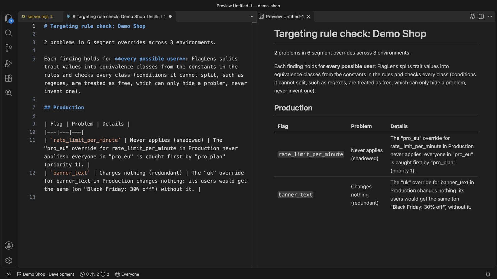
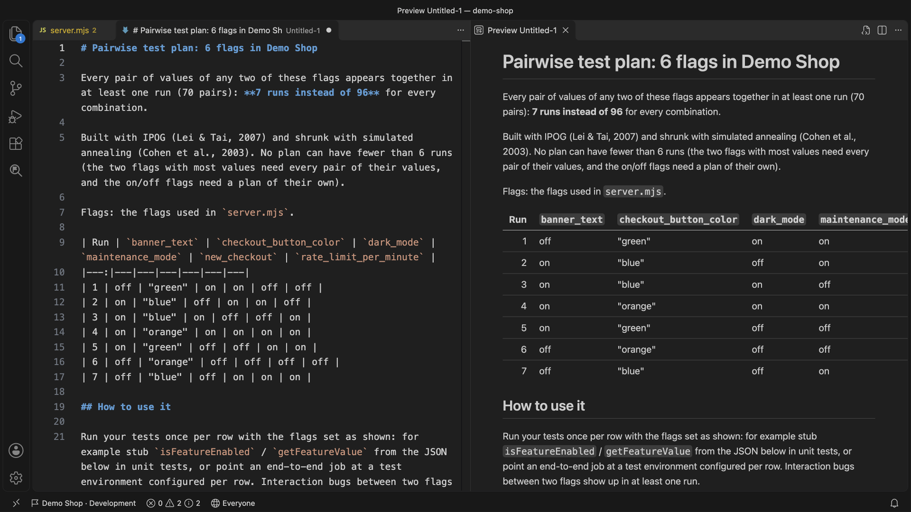
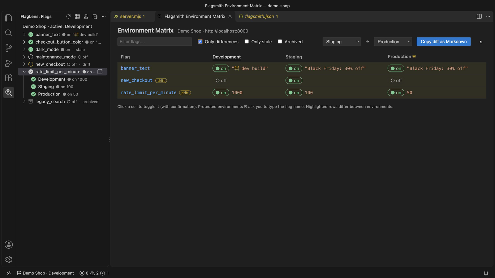
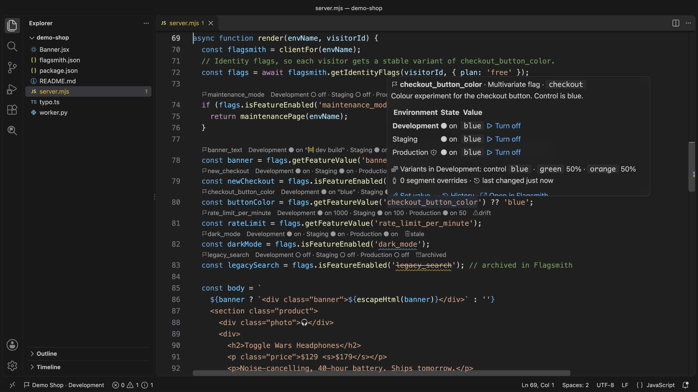
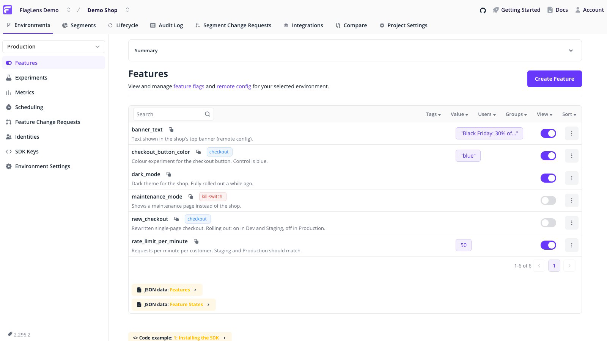
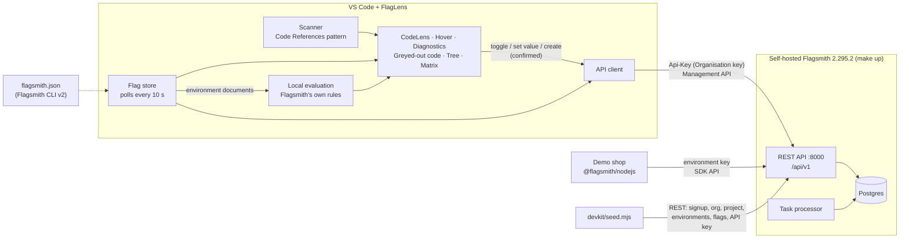

# FlagLens for Flagsmith

> See and safely change your **self-hosted Flagsmith** flags right where they live in your code, and catch environment
> drift, typos and stale flags before they bite.

[](https://github.com/Pranav-Singh-Devloper/flaglens/actions/workflows/ci.yml)
· **Toggle Wars 2026, Track 03: Build on Open Source Flagsmith**
· [▶ Demo video](#demo) · [⬇ Download the .vsix](https://github.com/Pranav-Singh-Devloper/flaglens/releases/latest)

FlagLens is two things that work together:

1. **A VS Code extension** that puts live Flagsmith state next to every flag in your code: every environment's
   on/off and value, a ⚠ when Staging and Production disagree, squiggles under misspelled flag keys, and safe,
   confirmed toggles without leaving the editor. It also **greys out code that can't run** in the environment you
   pick, and lets you **preview every flag as a specific user**, evaluated locally with Flagsmith's own segment,
   % split and override rules (checked against the server: 14,400 checks, 100% match). It **checks your targeting
   rules** for overrides that can never apply or change nothing, and builds the **smallest test plan** that tries every
   pair of flag values together.
2. **A one-command self-hosted dev kit**: `make up && make seed` starts the official open-source Flagsmith 2.295.2
   in Docker and fills it with a realistic demo project, so anyone can try the extension in about five minutes.

It is a community project, not an official Flagsmith product.


```
⚑ new_checkout   Development ● on · Staging ● on · Production ○ off   ⚠ drift
if (flags.isFeatureEnabled('new_checkout')) {

⚑ rate_limit_per_minute   Development ● on 1000 · Staging ● on 100 · Production ● on 50   ⚠ drift
const limit = flags.getFeatureValue('rate_limit_per_minute');

if (flags.isFeatureEnabled('new_chekout')) {      ← Flag "new_chekout" doesn't exist in Flagsmith. Did you mean "new_checkout"?
                            ~~~~~~~~~~~              Quick fix: Replace with "new_checkout" · Create flag in Flagsmith…

⚑ new_checkout   👤 Beta tester:  Development ● on · Staging ● on · Production ● on (beta_testers)
${newCheckout ? 'new' : 'old'}                    ⟵ new_checkout is on → never runs (Production · Beta tester)
                        ░░░░░                        (greyed out, like an inactive #ifdef)
```

## Screenshots

| | |
|---|---|
|  **Greys out code that can't run** in the active environment, with the reason: here the old checkout, because `new_checkout` is on in Development. |  **Preview as a user**: Production is off for everyone, but on for this beta tester via the `beta_testers` segment. CodeLens, hover and greying all follow. |
|  **Targeting rule check**: an override that can never apply (`pro_eu`, shadowed by `pro_plan`) and one that changes nothing (`uk`). Each finding holds for every possible user. |  **Pairwise test plan**: every pair of values of 6 flags in 7 runs instead of 96, with JSON and a GitHub Actions matrix to paste. |
|  **Live state inline**: every environment above every flag, with ⚠ drift, 🗑 stale and archived badges. |  **Environment Matrix**: every flag × environment, differences highlighted, copy the diff as Markdown. |
|  **Typo detection**: unknown keys are underlined, with *Replace with…* and *Create flag…* quick fixes. |  **Protected environments**: changing Production means typing the flag's name. |
|  **Hover card**: every environment's state and value, variant weights, overrides, last change, one-click toggles. |  **The demo shop** (`make demo`): banner, checkout and button colour all come from self-hosted Flagsmith. |
|  **Archived and stale flags** show up as problems, computed locally on open-source Flagsmith. |  **Same data as the dashboard**: every value comes from your self-hosted Flagsmith. |

## Why

- **Context switching.** You read `isFeatureEnabled("new_checkout")` and can't tell whether it's on in production
  without opening the dashboard, picking the project, then the environment, then searching. Then again for staging.
- **Environment drift.** "What you want to know at 2 AM is whether staging and production disagree." Today that means
  clicking through every environment.
- **Silent typos.** `isFeatureEnabled("new_chekout")` doesn't error: every SDK returns the default and the feature
  never ships.
- **"Which branch actually runs for this user?"** Segments, % splits and identity overrides decide, and they live in
  the dashboard, far from the `if` they control. Reading the code, you can't tell which half is dead.
- **Flag debt on open source.** Flags stay fully on for months. Flagsmith's stale-flag detection is a paid SaaS
  feature, and on self-hosted open-source Flagsmith even the audit-log API returns nothing. FlagLens computes
  staleness itself.

## What it does

| | Feature | Flagsmith API it uses |
|---|---|---|
| 🔍 | Live state of every environment above each flag reference (CodeLens) and in a hover card with values, variant weights, overrides and last change | `GET /projects/{id}/features/`, `GET /environments/{key}/featurestates/` |
| 👤 | **Preview as a user**: pick a test user (identifier + traits) from the status bar, and every CodeLens, hover and greyed-out region shows what *that user* gets, and why: segment and priority, % split bucket, identity override. Evaluated locally from the environment document with Flagsmith's own rules (ported from its open-source engine), and [verified against the server](#development-and-tests) | `GET /environments/{key}/document/` |
| 🌫 | **Greys out code that can't run** in the active environment (and for the previewed user), like an inactive `#ifdef`: the losing branch of `if`/`else` and ternaries, through simple `const x = flags…` aliases, and the rest of a block after a flag guard that returns. JS/TS and other brace languages, and Python. It uses three-valued logic, so it only greys code when the outcome is **certain**: a flag with a segment override counts as unknown for "everyone" | environment document + feature states |
| 🧭 | **Targeting rule check**: finds segment overrides that can **never apply** (every user they match is caught first by higher-priority overrides), overrides that **change nothing**, segments that **match nobody**, and defaults **nobody gets**. Each finding is proven for every possible user (see [How the checks work](#how-the-checks-work)). Shown in CodeLens, hovers, the Problems panel and a Markdown report | environment documents |
| 🧪 | **Pairwise test plan**: the smallest set of runs in which every pair of values of the chosen flags appears together. Provably optimal for on/off flags (Kleitman–Spencer); near-optimal with a stated lower bound for multivariate flags. Exports a table, JSON and a GitHub Actions matrix | feature states, variants, environment documents |
| 🔁 | **Safe toggles and value edits**: modal confirmation, typed confirmation for protected environments (`prod\|live\|main`), Undo, every change logged | `PATCH /environments/{key}/featurestates/{id}/` |
| ⚠️ | **Drift badge** when Staging ≠ Production, **Environment Matrix** of every flag × environment, **Copy diff as Markdown** for a PR | feature states × environments |
| ✍️ | **Typo detection** for unknown keys with *Replace with…* and *Create flag in Flagsmith…* quick fixes (respects the project's naming rules) | `POST /projects/{id}/features/` |
| 🧹 | **Stale flags on open-source Flagsmith**: identical in every environment for N days, no targeting, not tagged permanent | `updated_at` of feature states, tags (`is_permanent`) |
| 🗄 | **Archived flags still referenced** in code are flagged for removal | `is_archived` |
| 🔒 | **Experiment lock**: flags in a running experiment are badged and can't be toggled | `GET /environments/{key}/experiments/` (beta) |
| ⌨️ | Autocomplete flag keys inside `isFeatureEnabled("…")`, sidebar tree, status-bar environment switcher, flag history, *Find unused flags* in the workspace | all of the above |
| 🐳 | **Dev kit**: pinned official images, idempotent REST seed, demo shop using the official Node SDK | Docker, REST, SDK API |

It fits the existing Flagsmith toolchain instead of inventing its own:

- It reads **`flagsmith.json`**, the config file written by the official Flagsmith CLI (`flagsmith init`), to pick
  the project and default environment.
- It finds flag keys with **the same pattern as Flagsmith's own Code References scanner**
  ([Flagsmith/ci](https://github.com/Flagsmith/ci)), so `is_feature_enabled("x")`, `isFeatureEnabled('x')`,
  `hasFeature("x")`, `getFeatureValue("x")`, `IsFeatureEnabled("x")`… work in JS/TS, Python, Go, Java, Kotlin, C#,
  Dart and Ruby. Two extra patterns add the JS client's `flagsmith.getValue('x')` and the React SDK's
  `useFlags(['x', 'y'])`, which the official scanner misses.

## Quick start (about 5 minutes)

**Prerequisites:** [Docker](https://docs.docker.com/get-docker/) with Compose v2 (Docker Desktop is fine),
Node.js 22 or newer, VS Code 1.95 or newer, and `make` (on Windows, use the `npm run …` command shown next to each step).

```bash
git clone https://github.com/Pranav-Singh-Devloper/flaglens.git && cd flaglens

make up      # start self-hosted Flagsmith 2.295.2 on http://localhost:8000      (npm run devkit:up)
make seed    # admin user, "Demo Shop" project, 3 environments, 7 flags, .env      (npm run devkit:seed)
make demo    # the demo shop on http://localhost:3030, reading flags via the SDK   (npm install && npm run demo)
```

The first `make up` pulls the images and runs database migrations, which takes 1–3 minutes. It returns once Flagsmith
is healthy.

Then install the extension, in either of two ways:

- **Download** `flaglens-0.3.0.vsix` from [Releases](https://github.com/Pranav-Singh-Devloper/flaglens/releases/latest),
  then in VS Code: Command Palette → **Extensions: Install from VSIX…** → pick the file.
- **Or build it**: `make package` (npm: `npm install && npm run package`) creates `extension/flaglens.vsix`. If the
  `code` command is on your PATH, `make install-ext` builds and installs it in one step.

Finally open the demo workspace: **File → Open Folder… → `flaglens/examples/demo-shop`**
(or `code examples/demo-shop`). FlagLens notices the `.env` that `make seed` wrote and asks
**"Connect with it?"**. Click **Connect**.

### What success looks like

- `make seed` ends with a box: `✔ Self-hosted Flagsmith is seeded and ready.`
- VS Code's status bar shows **`⚑ Demo Shop · Development`**.
- In `server.mjs`, above `isFeatureEnabled('new_checkout')`, you see
  `⚑ new_checkout   Development ● on · Staging ● on · Production ○ off`, and `rate_limit_per_minute` shows **⚠ drift**.
- `typo.ts` has a yellow squiggle under `new_chekout` (try the quick fix) and a blue hint on `dark_mode` (stale).
- Click the `new_checkout` CodeLens → **Turn off in Development** → confirm. Within 3 seconds the shop at
  http://localhost:3030 switches back to the classic checkout. Try Production: you'll be asked to type the flag name.
- Code that can't run is greyed, with the reason at the end of the line: in `server.mjs` the old three-step checkout
  shows `⟵ new_checkout is on → never runs (Development)`, and in `typo.ts` the branch behind the typo is greyed
  because `new_chekout` doesn't exist.
- Click **🌐 Everyone** in the status bar → **Beta tester**, then switch to Production (click the environment in the
  status bar). The `new_checkout` CodeLens now reads `Production ● on (beta_testers)`, the old checkout is greyed out
  for this user, and the hover shows which segment decided.
- The Problems panel lists two **targeting rule** findings in `server.mjs`: the `pro_eu` override for
  `rate_limit_per_minute` never applies (shadowed by `pro_plan`), and the `uk` override for `banner_text` changes
  nothing. **FlagLens: Check Targeting Rules** shows them as a report.
- **FlagLens: Generate Pairwise Test Plan…** with `server.mjs` open preselects its flags. *On/off only* gives
  **7 runs instead of 96**.
- The Flagsmith dashboard at http://localhost:8000 shows the same change. Log in with
  `admin@flaglens.local` / `FlagLens-demo-2026`.

Something wrong? See [Troubleshooting](#troubleshooting).

## Use it with your own Flagsmith

1. Command Palette → **FlagLens: Connect to Flagsmith**.
2. Enter your API URL: your self-hosted instance (e.g. `https://flags.mycompany.com`), or `https://api.flagsmith.com`
   for Flagsmith Cloud.
3. Paste an **Organisation API key** (dashboard → Organisation Settings → API Keys). It is stored in VS Code's
   encrypted SecretStorage, one key per server, and never written to settings or logs.
4. Pick the project. If your repo already has a `flagsmith.json` from the Flagsmith CLI, FlagLens uses it
   (`project` and `environment` may be ids, names or a client-side key).

## Commands

| Command | |
|---|---|
| FlagLens: Connect to Flagsmith… / Sign Out | Connect, or forget the stored API key |
| FlagLens: Toggle Flag… / Set Flag Value… | Change a flag in one environment (with confirmation) |
| FlagLens: Create Flag in Flagsmith… | Create a flag (starts OFF everywhere) |
| FlagLens: Open Environment Matrix | Every flag × environment, differences highlighted, click to toggle |
| FlagLens: Copy Environment Diff as Markdown… | Paste-ready table of differences between two environments |
| FlagLens: Show Flag History… | Audit log (if the server exposes it), last change per environment, changes made with FlagLens |
| FlagLens: Find Unused Flags in Workspace | Project flags that no file references |
| FlagLens: Preview Flags as User… | Pick a test user (from `flaglens.personas`, or type an identifier and traits). Also: click the 👤/🌐 item in the status bar |
| FlagLens: Toggle Greying Out Code That Won't Run | Turn the greying on or off |
| FlagLens: Check Targeting Rules | Report of segment overrides that never apply, change nothing or match nobody, per environment |
| FlagLens: Generate Pairwise Test Plan… | Pick flags (the open file's are preselected): the smallest plan covering every pair of their values |
| FlagLens: Switch Active Environment… / Switch Project… / Refresh Flags / Show Log | |

## Configuration

| Setting | Default | Purpose |
|---|---|---|
| `flaglens.apiUrl` | `http://localhost:8000` | Flagsmith API base URL, without `/api/v1`. If unset: `apiUrl` in `flagsmith.json`, then `FLAGSMITH_API_URL` in the workspace `.env`. |
| `flaglens.dashboardUrl` | same as `apiUrl` | Dashboard base for links (`https://app.flagsmith.com` is used automatically for Cloud) |
| `flaglens.projectId` | from `flagsmith.json` | Project to show |
| `flaglens.activeEnvironment` | from `flagsmith.json` | Environment used by the status bar, tree and autocomplete |
| `flaglens.refreshIntervalSeconds` | `10` | Polling interval (minimum 3) |
| `flaglens.protectedEnvironments` | `prod\|live\|main` | Case-insensitive regex; matching environments need the flag name typed to confirm a change |
| `flaglens.driftEnvironments` | `["Staging", "Production"]` | The pair compared for the ⚠ drift badge |
| `flaglens.staleAfterDays` | project's `stale_flags_limit_days`, else `30` | Days unchanged before a uniform flag counts as stale |
| `flaglens.permanentTags` | `["permanent", "kill-switch"]` | Tags that are never stale (tags marked *permanent* in Flagsmith count too) |
| `flaglens.extraPatterns` | `getValue` and `useFlags` patterns | Extra regexes with a named group `key` |
| `flaglens.codeLens.enabled` | `true` | Show the inline states |
| `flaglens.diagnostics.unknownFlagSeverity` | `warning` | `error`, `warning`, `information` or `off` |
| `flaglens.diagnostics.staleFlags` | `true` | Show stale-flag hints |
| `flaglens.personas` | `[]` | Test users for *Preview as*: `[{ "name": "Beta tester", "identifier": "alice@demo-shop.dev", "traits": { "plan": "pro" } }]`. The demo workspace defines three |
| `flaglens.dimInactiveCode` | `true` | Grey out code that can't run in the active environment (and for the previewed user) |

## Environment variables (dev kit)

`make seed` writes a git-ignored `.env` at the repo root and a copy in `examples/demo-shop/.env`.
[`.env.example`](.env.example) documents every variable. You only need to set one yourself to change a default
**before** seeding.

| Variable | Default | Used by | Purpose |
|---|---|---|---|
| `FLAGSMITH_API_URL` | `http://localhost:8000` | seed, demo shop, extension | Flagsmith base URL |
| `FLAGSMITH_API_KEY` | written by seed | extension (offered on first open) | Organisation API key. **Secret.** |
| `FLAGSMITH_ORGANISATION_ID` | written by seed | reference | |
| `FLAGSMITH_PROJECT_ID` | written by seed | extension | |
| `FLAGSMITH_ENV_KEY_DEVELOPMENT`, `…_STAGING`, `…_PRODUCTION` | written by seed | demo shop | Client-side environment keys (public by design) |
| `ADMIN_EMAIL` / `ADMIN_PASSWORD` | `admin@flaglens.local` / `FlagLens-demo-2026` | seed | Dev-kit dashboard login |
| `DEMO_PORT` | `3030` | demo shop | |
| `DEMO_ENVIRONMENT` | `Development` | demo shop | Environment the shop reads by default (`?env=Production` overrides) |
| `FLAGSMITH_PORT` | `8000` | `make up` (shell variable) | Host port if 8000 is taken: `FLAGSMITH_PORT=8080 make up`, then set `FLAGSMITH_API_URL=http://localhost:8080` |

### Dev kit commands

| make | npm | |
|---|---|---|
| `make up` | `npm run devkit:up` | Start Flagsmith (waits until healthy) |
| `make seed` | `npm run devkit:seed` | Seed or re-seed. Safe to re-run: it restores every demo flag to its declared state ([`devkit/seed-data.json`](devkit/seed-data.json)) |
| `make demo` | `npm run demo` | Run the demo shop |
| `make down` / `make reset` | `npm run devkit:down` / `devkit:reset` | Stop / stop **and delete all data** |
| `make logs` | `npm run devkit:logs` | Follow Flagsmith logs |
| `make mcp` | `npm run devkit:mcp` | Also start Flagsmith's MCP server on :8002 |

The seeded flags are designed so every feature is visible:

| Flag | Development | Staging | Production | Shows |
|---|---|---|---|---|
| `new_checkout` | on | on | off | Toggle it live; the shop's checkout changes |
| `banner_text` | `🚧 dev build` | `Black Friday: 30% off` | `Black Friday: 30% off` | Values inline; the shop banner |
| `rate_limit_per_minute` | 1000 | 100 | 50 | **⚠ drift** between Staging and Production |
| `checkout_button_color` | blue / green 50% / orange 50% | same | same | Multivariate variants and weights |
| `dark_mode` | on | on | on | **Stale** (the demo workspace sets `staleAfterDays: 0`) |
| `maintenance_mode` | off | off | off | Tagged `kill-switch` (permanent), so never stale |
| `legacy_search` | off | off | off | **Archived** but still referenced |

Production also has four segments with overrides, so *Preview as* has something to show (the demo workspace's
`flaglens.personas` match them):

| Segment | Rule | Production override |
|---|---|---|
| `beta_testers` | `email` matches `.*@demo-shop\.dev$` | `new_checkout` on |
| `pro_plan` | `plan` = `pro` | `rate_limit_per_minute` = 500 |
| `india` | `country` = `IN` | `banner_text` = "Diwali sale: 40% off" |
| `canary_10pct` | 10% split on the identity | `checkout_button_color` = purple |
| `pro_eu` | `plan` = `pro` and `country` in DE, FR, GB | `rate_limit_per_minute` = 800. **Deliberate mistake:** `pro_plan` catches these users first |
| `uk` | `country` = `GB` | `banner_text` = "Black Friday: 30% off". **Deliberate mistake:** the same as the default |

## How it uses Flagsmith

Remove Flagsmith and FlagLens does nothing: every badge, value and warning is live data from the Flagsmith API, and
every change is a Flagsmith write.



- **Management API, read.** On each refresh: environments, `GET /projects/{id}/features/`, tags, and one
  `GET /environments/{key}/featurestates/` per environment. This gives enabled, value, `updated_at` and per-environment
  variant weights for every flag in N+1 requests, joined into a feature × environment matrix. Experiments (beta) are
  read per environment to show the 🔒 lock.
- **Environment documents.** `GET /environments/{key}/document/` (readable with the same Organisation key) returns
  every flag's default, every segment with its rules and overrides, and identity overrides: the document Flagsmith's
  server-side SDKs use for local evaluation. FlagLens evaluates it with a TypeScript port of Flagsmith's open-source
  engine (identity key `envkey_identifier`, `md5` percentages mod 9999, segment priorities, multivariate buckets,
  all 14 rule operators), which powers *Preview as* and tells the greying-out exactly which flags are the same for
  every user.
- **Management API, write.** Toggles and values are `PATCH /environments/{key}/featurestates/{id}/` on the
  environment's default state (raw JSON values keep their type). New flags are `POST /projects/{id}/features/`. Every
  write also appears in Flagsmith's own audit log.
- **SDK API.** The demo shop uses the official `@flagsmith/nodejs` SDK with remote evaluation and per-visitor
  identities, so it serves multivariate variants and picks up changes on the next request.
- **Dev kit.** The seed uses only the public REST API (signup → organisation → project → environments → tags → flags →
  Organisation API key), so it doubles as a worked example of bootstrapping Flagsmith without clicking.

## How the checks work

**Targeting rules.** Segment overrides are a priority-ordered list of rules over user traits, which is exactly the
shape of a firewall policy, so FlagLens borrows its anomaly taxonomy (Al-Shaer & Hamed, *Firewall Policy Advisor*,
2004): an override is **shadowed** when higher-priority ones catch every user it matches, and **redundant** when
removing it changes no user's result. Checking "every user" exactly is possible because each comparison operator
(`=`, `≠`, `IN`, `<`, `≤`, `>`, `≥`, `IS_SET`, % split) gives the same answer for all values between two consecutive
constants that appear in the rules. Trait values therefore split into a few equivalence classes (unset, each constant,
each gap, other strings, numbers and booleans, since the engine casts the condition to the trait's type), and
checking one representative per class combination is a proof for all users. Operators that can't be split this way
(regex, contains, modulo, SemVer) become free true/false variables, which only adds impossible users: a finding can be
missed, but never invented. A randomised test checks this against the evaluation engine on 150 random rule sets, and
`make verify-engine` confirms on the live server that users inside a shadowed segment never get its value.

**Pairwise plans.** Most flag bugs involve one flag or the interaction of two, so a plan that puts every pair of
values together in some run catches them without trying every combination. For on/off flags the minimum is known
exactly: the smallest N with C(N−1, ⌈N/2⌉) ≥ k (Katona; Kleitman & Spencer, 1973), reached by giving each flag a
distinct length-N column that starts with 0 and has ⌈N/2⌉ ones. That is 6 runs for 10 flags, 10 for 100 and 14 for
1,000. With multivariate flags FlagLens builds a plan with IPOG (Lei & Tai, 2007), shrinks it with simulated annealing
(Cohen, Colbourn & Ling, 2003), and states a lower bound so you know how close it is.

## Architecture

```
devkit/            compose.yaml (pinned 2.295.2 + optional MCP), seed.mjs + seed-data.json (zero-dependency Node)
extension/src/
  api/             typed Management API client: fetch, Api-Key auth, pagination, timeouts, typed errors
  core/            PURE logic, unit-tested: scanner (Code References pattern), model (matrix), analysis (drift,
                   stale, typo suggestions, name rules), report (Markdown diff), engine (Flagsmith's evaluation
                   rules, ported), deadcode (lexer + if/else/ternary/alias analysis with three-valued logic),
                   rules (override anomalies over trait equivalence classes), pairwise + testPlan (covering arrays)
  store/           FlagStore: polling, change detection, offline handling with backoff
  providers/       CodeLens, hover, diagnostics + quick fixes, autocomplete, greyed-out code decorations
  views/           sidebar tree, status bar, Environment Matrix webview
  commands/        connect, toggle, set value, create, history, diff, find unused, preview as user, rule check,
                   test plan
  safety.ts        confirmations, protected environments, write journal
examples/demo-shop the shop (Node SDK), plus Python / React / TypeScript files used in the demo
```

- **Zero runtime dependencies.** The extension uses only the VS Code API and Node's global `fetch`. The packaged
  `.vsix` is about 51 KB.
- Activation is cheap (`workspaceContains:**/flagsmith.json` or after startup). The matrix webview loads only when opened.
- Only open documents are scanned (debounced, cached by document version). *Find unused flags* scans the workspace on
  demand.

## Security

- The Organisation API key lives in VS Code SecretStorage only, keyed by server URL. It is never written to settings,
  logs or the workspace. **FlagLens: Sign Out** deletes it.
- Every change asks for confirmation. Protected environments also require typing the flag name, and Undo goes through
  the same check. Changes are logged to the *FlagLens* output channel and to Flagsmith's audit log.
- FlagLens warns when you connect to a remote server over plain `http://`.
- In untrusted workspaces FlagLens ignores the workspace's `flagsmith.json` and `.env`, because they decide which server
  receives your key.
- The webview has a strict Content-Security-Policy (no remote content, nonce-only scripts).
- `.env` files are git-ignored. The dev kit uses Flagsmith's local defaults (`DJANGO_SECRET_KEY=secret`, Postgres
  password `password`). They are fine on your laptop: **don't expose the dev kit to the internet.**

## Development and tests

```bash
npm install
npm run check                    # lint + type-check + unit tests (extension and dev kit)
npm run build                    # bundle the extension (esbuild)
# Press F5 in VS Code (open the repo root) to start an Extension Development Host.

make up && make seed
npm run test:integration -w extension   # end-to-end: real VS Code + real self-hosted Flagsmith
make verify-engine                      # local evaluation vs the live server (npm run verify:engine -w extension)
```

- **Unit tests** (Vitest, ~170 tests) cover the scanner (call styles in 9 languages, multi-line calls, false
  positives), drift and staleness rules, typo suggestions, the API client (pagination, internal hostnames in `next`,
  timeouts, retry rules, error mapping), the Markdown diff, the evaluation engine (hashes checked against values
  computed independently with Python's `hashlib`, a chi-square test that splits are uniform, priorities, every
  operator), the dead-code analysis (if/else, guards, ternaries, aliases, Python, unknown operands), the rule checker
  (each anomaly, type casting, plus the randomised soundness test above) and the pairwise plans (exact optimal size
  for every k from 1 to 200, full pair coverage for 300 random mixes).
- **Engine verification** (`make verify-engine`) asks the running Flagsmith what hundreds of random identities get,
  using *transient* identities so nothing is stored, and compares every flag with FlagLens's local answer. A second
  pass creates one temporary segment per rule operator (`EQUAL` … `REGEX`, `IN`, `MODULO`, SemVer, `IS_SET`, % split,
  JSONPath properties), runs the comparison, and deletes them again. Last run: 6,300 + 8,100 checks, **100% match**.
  It also checks the rule checker's "never applies" findings against the server.
- **End-to-end tests** launch VS Code with the demo workspace against the seeded Flagsmith and check CodeLens, hover,
  diagnostics, quick fixes, autocomplete, a real toggle and toggle-back, pick-up of a change made outside the editor,
  that a declined confirmation changes nothing, the Markdown diff, *Preview as* (including a comparison with the
  server's answer for the same user), greying out (including that nothing is greyed when users can differ), the rule
  check and the test plan.
- **CI** runs both on every push, including `make up && make seed` (twice, to prove the seed is idempotent) on a
  fresh Ubuntu runner.

## Limitations and roadmap

- **v2-versioned environments are read-only.** FlagLens shows them and links to the dashboard. The versions flow
  (create version → edit → publish) is on the roadmap.
- **Polling, not push.** Changes appear within `refreshIntervalSeconds` (default 10). Real-time updates are an
  Enterprise feature; environment webhooks to a local listener are on the roadmap.
- **Segment and identity overrides are previewed and counted, not edited.**
- **Greying out is an analysis of common shapes, not a full parser.** It understands `if`/`else`, guards that return,
  ternaries and `const` aliases in the same block; JSX `{flag && <X/>}`, `switch` and values passed through other
  functions are left alone (never greyed by mistake: when unsure it does nothing).
- **Local evaluation assumes composite-key hashing** (`use_identity_composite_key_for_hashing`, the default on
  current Flagsmith). Environments created before that setting existed may bucket stored identities differently.
- **Detection is pattern-based**, like Flagsmith's Code References: keys built at runtime (`isFeatureEnabled(name)`)
  aren't seen. Custom wrappers can be added with `flaglens.extraPatterns`.
- **History on open-source Flagsmith is partial.** The server hides audit-log entries from the API without a
  licence, so *Show history* combines the audit log (when available), each environment's last change and FlagLens's own
  change journal.
- **Experiment results** aren't rendered yet; only the lock badge is.
- Single-root workspaces. Multi-root support (one connection per folder) is on the roadmap.

## Things we learned about Flagsmith while building this

Checked against a live 2.295.2 instance (these shaped the design):

- `last_modified_in_any_environment` is filled only by v2 feature versioning, so it's `null` on default environments.
  FlagLens uses feature-state `updated_at` instead.
- The project audit-log API returns no rows on unlicensed self-hosted instances (`audit_log_visibility_days = 0` on the
  free plan), even though the rows are in the database.
- `GET /api/v1/audit/` returns HTTP 500 when called with an Organisation API key, and
  `PATCH …/mv-options/{id}/` without `default_percentage_allocation` returns HTTP 500 (`KeyError`). Multivariate
  `key`s sent when creating a feature are ignored. The seed works around this.
- `POST /projects/` creates no environments, and `GET /projects/` returns a plain array rather than a paginated object.
- `num_segment_overrides` in the features list is only counted when you pass `?environment=`; without it it's always 0.
  FlagLens counts overrides from the environment documents instead.
- `GET /environments/{key}/document/` works with an Organisation API key, so local evaluation needs no server-side
  environment key.
- A segment override of a multivariate flag copies the flag's variant split unless you send
  `multivariate_feature_state_values` with 0%, so the override's own value would never be served. The seed does that.
- The `REGEX` operator is anchored at the start (Python's `re.match`): `demo-shop` doesn't match `a@demo-shop.dev`.
- Rule values are cast to the trait's type before comparing, so a boolean trait `true` EQUALs *any* value except
  `"false"`: a segment `plan = pro AND plan = free` does match someone (`plan: true`). The rule checker accounts for it.

## Troubleshooting

| Symptom | Fix |
|---|---|
| `make up` says port 8000 is in use | `FLAGSMITH_PORT=8080 make up`, then put `FLAGSMITH_API_URL=http://localhost:8080` in `.env` before `make seed` |
| `make seed`: "Could not log in" | You changed `ADMIN_PASSWORD` after the first seed. Start fresh: `make reset && make up && make seed` |
| Status bar shows ⚠ and "Can't reach Flagsmith" | Flagsmith isn't running: `make up`. FlagLens keeps the last known state and reconnects by itself |
| "Flagsmith rejected the API key" | After `make reset` the old key is gone. Run `make seed`, then **FlagLens: Connect to Flagsmith** → *Use the key from .env* |
| No "Connect with it?" prompt | Open the `examples/demo-shop` folder itself (the prompt reads `.env` at the workspace root), or run **FlagLens: Connect to Flagsmith** |
| `make demo` exits with "No FLAGSMITH_ENV_KEY_*" | Run `make seed` first |
| No CodeLens | Check `editor.codeLens` and `flaglens.codeLens.enabled` are on, and that the status bar says connected |

## Demo

▶ **Demo video (2:29, 1080p60):** [flaglens-demo.mp4](https://github.com/Pranav-Singh-Devloper/flaglens/releases/download/v0.1.1/flaglens-demo.mp4)
(recorded with v0.1; *Preview as* and greying out are shown in the screenshots above)

Everything in the video is real: the VS Code footage is the released extension, driven by a script against the
self-hosted Flagsmith from `make up && make seed`. The video itself is built in code (Playwright-driven capture,
Manim, Remotion, ElevenLabs audio); see [video/](video/) to rebuild it.

## Built with AI assistance

AI coding assistants helped write parts of this project. Every line was reviewed, and the author understands and can
explain all of the code.

## Team · Licence

Built by [Pranav Singh](https://github.com/Pranav-Singh-Devloper) for Toggle Wars 2026 (WeMakeDevs × Flagsmith),
Track 03.

[MIT](LICENSE). Flagsmith is © Flagsmith Ltd. and BSD-3-Clause licensed; FlagLens is an independent community project.
