<p align="center">
  <picture>
    <source media="(prefers-color-scheme: dark)" srcset="docs/brand/flaglens-wordmark-dark.png">
    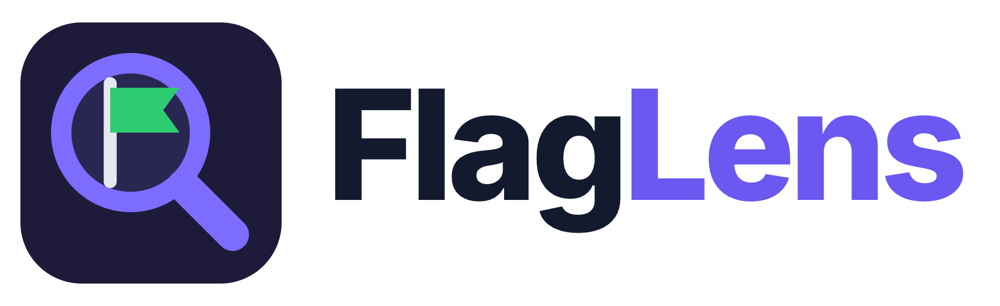
  </picture>
</p>

<p align="center"><b>See, test and trust your self-hosted Flagsmith flags, right where they live in your code.</b></p>

<p align="center">
  <a href="https://github.com/Pranav-Singh-Devloper/flaglens/actions/workflows/ci.yml"></a>
  <a href="https://github.com/Pranav-Singh-Devloper/flaglens/releases/latest"></a>
  <a href="https://open-vsx.org/extension/pranav-singh-devloper/flaglens"></a>
  
  
  <a href="LICENSE"></a>
</p>

<p align="center">
  <b><a href="https://youtu.be/n9qszMKXoB4">Watch the 2:33 demo</a></b> ·
  <a href="https://flaglens-one.vercel.app">Website</a> ·
  <a href="https://github.com/Pranav-Singh-Devloper/flaglens/releases/latest">Download the .vsix</a> ·
  <a href="docs/paper/flaglens.pdf">Research paper (PDF)</a> ·
  <a href="#quick-start-about-5-minutes">Quick start</a>
</p>

<p align="center"><i>Toggle Wars 2026 · Track 03: Build on Open Source Flagsmith</i></p>

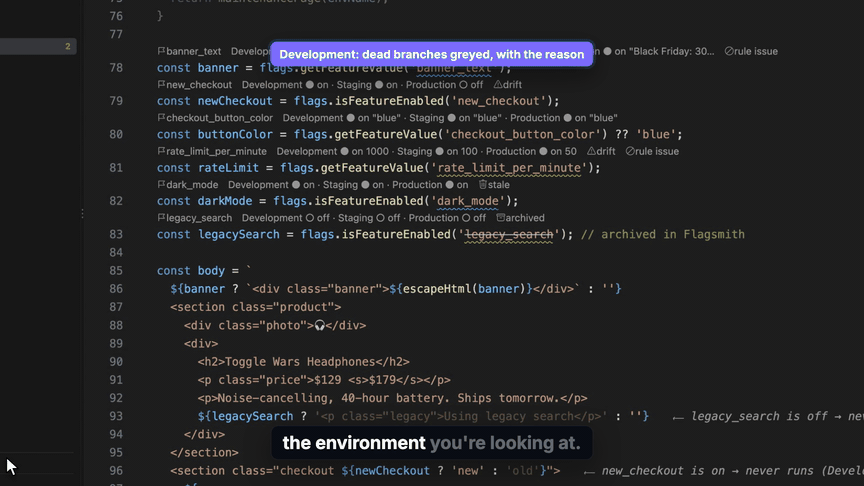

A flag check like `if (flags.isFeatureEnabled("new_checkout"))` hides the most important fact about the code below
it: **does it run, and for whom?** The answer lives in a dashboard, spread over environments, segments, priorities,
percentage splits and per-user overrides. FlagLens brings it into the editor, and backs every answer with a proof or
a check against your own Flagsmith server.

## In 60 seconds

FlagLens makes three promises, and proves each one:

| | What you see | Proof |
|---|---|---|
| **1. It knows what runs** | Code that can't run is greyed out, like an inactive `#ifdef`. Preview any user and every flag shows what they get, and why. | **15,050 of 15,050** local evaluations match the live Flagsmith server |
| **2. It proves your rules** | Segment overrides that can never apply, or change nothing, are flagged; fix them from the editor and the finding disappears. | Each finding holds for **every possible user** |
| **3. It's live** | A toggle in the Flagsmith dashboard reaches the editor in seconds. Feature Health alerts land on the code and in the confirmation. | **About 3 s** measured, through a signed Flagsmith webhook |

All of it runs on **self-hosted, open-source Flagsmith 2.295.2**, and every change is a confirmed Flagsmith write.

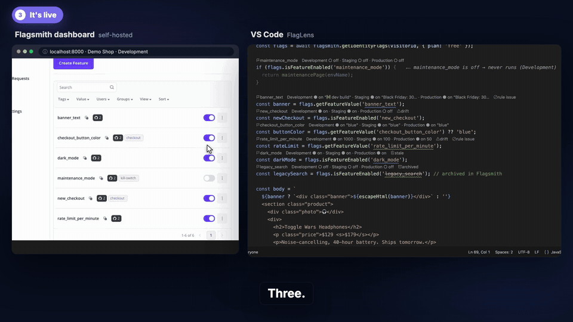

### Try it in 5 minutes

```bash
git clone https://github.com/Pranav-Singh-Devloper/flaglens && cd flaglens
make up && make seed      # self-hosted Flagsmith in Docker, with a demo project
make install-ext          # build and install the extension (or install the .vsix from Releases)
code examples/demo-shop   # then click "Connect" in the notification
```

Then, in `server.mjs`:

1. Read the live state above every flag, and the greyed-out code.
2. Click **Everyone** in the status bar → **Beta tester**: the code and CodeLens change to what that user gets.
3. Hover `rate_limit_per_minute` → **Segment overrides…** → Production → `pro_eu` → **Move up**. The rule warning disappears.
4. Toggle `maintenance_mode` in the dashboard (http://localhost:8000, `admin@flaglens.local` / `FlagLens-demo-2026`)
   and watch the editor follow.

### For judges: Track 03 at a glance

| Track 03 looks for | Where to see it |
|---|---|
| **Self-hosted Flagsmith** | `make up` starts the official Flagsmith 2.295.2 images ([compose.yaml](devkit/compose.yaml)); the demo, the tests and the video all run against it |
| **Flagsmith is central** | Remove it and FlagLens does nothing. [How much of Flagsmith it uses](#how-much-of-flagsmith-it-uses): flags, environment documents, segments and overrides, identities, v2 versions, webhooks, Code References, Feature Health, lifecycle, dependencies, trait keys, CLI config, SDK, MCP |
| **Integrations and plugins** | A VS Code extension, a Flagsmith organisation webhook, Code References from the editor or CI, Feature Health alerts |
| **Developer tools** | Greying out, *Preview as*, the rule check with fixes, test plans, typo fixes, drift, stale flags |
| **Easy for others to reuse** | On [Open VSX](https://open-vsx.org/extension/pranav-singh-devloper/flaglens) (verified publisher) and as a `.vsix`; two commands to a seeded instance, [every environment variable](#environment-variables-dev-kit), [what success looks like](#what-success-looks-like), CI that seeds twice on a fresh machine, MIT licence |
| **Open-source citizenship** | Three Flagsmith bugs found while building this, reported ([#9117](https://github.com/Flagsmith/flagsmith/issues/9117), [#9118](https://github.com/Flagsmith/flagsmith/issues/9118), [#9119](https://github.com/Flagsmith/flagsmith/issues/9119)), and a fix with regression tests for #9118 in [Flagsmith#9123](https://github.com/Flagsmith/flagsmith/pull/9123) |
| **Quality** | 192 unit and 23 end-to-end tests against real Flagsmith; the engine verified on [15,050 checks](#development-and-tests); a [paper](docs/paper/flaglens.pdf) |
| **Demo video** | [2:33 on YouTube](https://youtu.be/n9qszMKXoB4), with captions and chapters |

Everything else is below: [what it does](#what-it-does), [how it uses Flagsmith](#how-much-of-flagsmith-it-uses),
[architecture](#architecture), [the research paper](#research).

## What makes it different, in detail

| Feature | Why you can trust it |
|---|---|
| **Greys out code that can't run** in the environment you pick (or for one user), like an inactive `#ifdef`, with the reason at the end of the line | Conditions are evaluated in three-valued logic: anything uncertain stays visible. It **never greys code that might execute**. |
| **Preview as any user**: pick an identity and traits; every CodeLens, hover and greyed line shows what *they* get, and which segment, split bucket or override decided | Flagsmith's own engine, run locally. **15,050 of 15,050** results match the live server across every rule operator and flag dependencies (`make verify-engine`). |
| **Targeting-rule check**: overrides that can never apply (shadowed), change nothing (redundant), segments that match nobody, defaults nobody gets | Each finding is **proven for every possible user**: trait values are split into equivalence classes, and anything that can't be split is over-approximated. |
| **Smallest test plan** for a set of flags: every pair of values meets in some run | **96 combinations → 7 runs**, provably minimal (Kleitman–Spencer for on/off flags, plus a lower bound we prove for mixed flags). |
| **Fix targeting where you read it**: set a flag for one user, add or reorder segment overrides, and the rule check re-runs at once | Every edit is a confirmed Flagsmith write. Move the shadowed `pro_eu` override up and its finding disappears. |
| **Real time**: a change made anywhere shows up in the editor in a few seconds | A Flagsmith organisation webhook to a listener in the editor; every call's HMAC-SHA256 signature is checked. |

And the essentials, done carefully: live state for every environment above each flag, safe toggles with typed
confirmation for Production and Undo (published as a new version in v2-versioned environments), environment drift and
a Markdown diff for PRs, typo detection with quick fixes, archived and stale flags (free on open-source Flagsmith),
autocomplete, history. Plus Flagsmith's own flag-management data, in the editor: flag dependencies, Feature Health
alerts, lifecycle stages, owners and Code References.

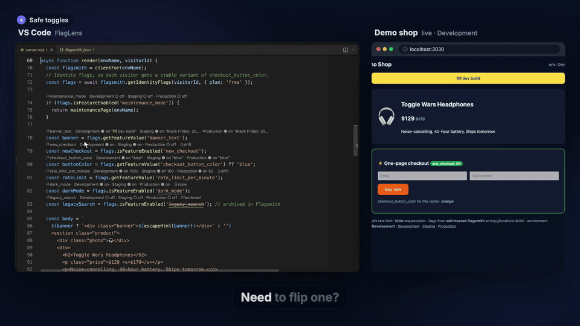

The math behind these four is written up in a short paper, **[FlagLens: Exact, Server-Verified Reasoning about
Feature Flags in the Editor](docs/paper/flaglens.pdf)** ([Markdown](docs/paper/flaglens.md)), with proofs, the
verification method and 27 references.

## Built on open-source Flagsmith

- **Self-hosted first.** `make up && make seed` starts the official open-source Flagsmith 2.295.2 images in Docker and
  seeds a realistic demo (3 environments, 7 flags, 6 segments, an API key) through Flagsmith's own REST API. No
  clicking, idempotent, tested in CI on a fresh machine.
- **Flagsmith is the whole point.** Every badge, value and finding comes from the Flagsmith API (management API,
  environment documents, transient identities), and every change is a confirmed Flagsmith write. Remove Flagsmith and
  FlagLens does nothing.
- **Uses Flagsmith's newer open-source features, not just flags and environments.** Flag dependencies, Code
  References (FlagLens publishes them, and Flagsmith then shows each flag's files and lines and moves it through its
  lifecycle), lifecycle stages, flag owners and Feature Health alerts all show up where the flag is used. Organisation
  webhooks give real-time updates; identity overrides, segment overrides and v2 feature versions are edited from the
  editor; trait keys feed *Preview as*. See [How much of Flagsmith it uses](#how-much-of-flagsmith-it-uses).
- **Fits the Flagsmith toolchain.** It reads the Flagsmith CLI's `flagsmith.json` and finds flags with the same pattern
  as Flagsmith's Code References scanner, in JS/TS, Python, Go, Java, Kotlin, C#, Dart and Ruby.
- **Tested against the real thing.** 192 unit tests, 23 end-to-end tests in a real VS Code against self-hosted
  Flagsmith, and a differential verifier for the local engine. Zero runtime dependencies; the extension is 62 KB.

```
⚑ new_checkout   Development ● on · Staging ● on · Production ○ off   ⚠ drift
if (flags.isFeatureEnabled('new_checkout')) {

if (flags.isFeatureEnabled('new_chekout')) {      ← Flag "new_chekout" doesn't exist in Flagsmith. Did you mean "new_checkout"?
                            ~~~~~~~~~~~              Quick fix: Replace with "new_checkout" · Create flag in Flagsmith…

⚑ new_checkout   👤 Beta tester:  Development ● on · Staging ● on · Production ● on (beta_testers)
${newCheckout ? 'new' : 'old'}                    ⟵ new_checkout is on → never runs (Production · Beta tester)
                        ░░░░░                        (greyed out, like an inactive #ifdef)
```

It is a community project, not an official Flagsmith product.

## Screenshots

| | |
|---|---|
| 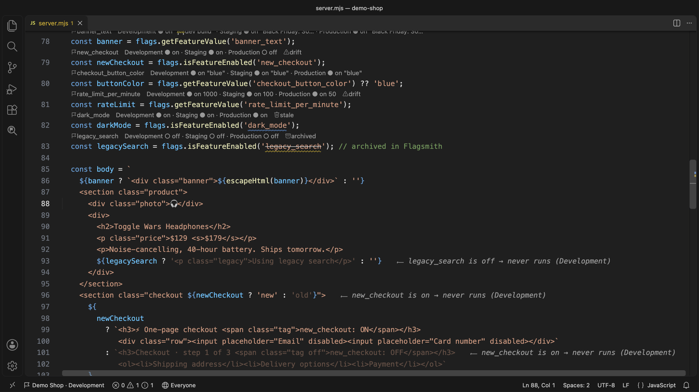 **Greys out code that can't run** in the active environment, with the reason: here the old checkout, because `new_checkout` is on in Development. | 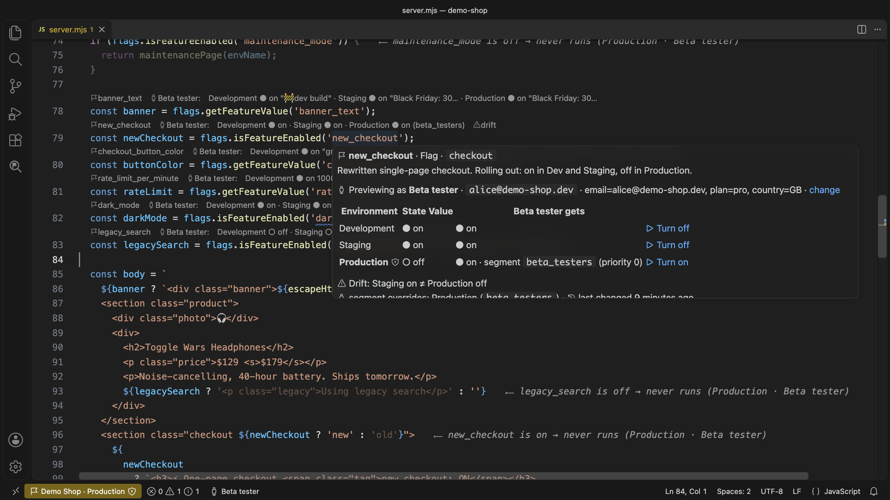 **Preview as a user**: Production is off for everyone, but on for this beta tester via the `beta_testers` segment. CodeLens, hover and greying all follow. |
|  **Targeting rule check**: an override that can never apply (`pro_eu`, shadowed by `pro_plan`) and one that changes nothing (`uk`). Each finding holds for every possible user. |  **Pairwise test plan**: every pair of values of 6 flags in 7 runs instead of 96, with JSON and a GitHub Actions matrix to paste. |
|  **Live state inline**: every environment above every flag, with drift, stale and archived badges. |  **Environment Matrix**: every flag × environment, differences highlighted, copy the diff as Markdown. |
|  **Typo detection**: unknown keys are underlined, with *Replace with…* and *Create flag…* quick fixes. |  **Protected environments**: changing Production means typing the flag's name. |
|  **Hover card**: every environment's state and value, variant weights, overrides, last change, one-click toggles. | 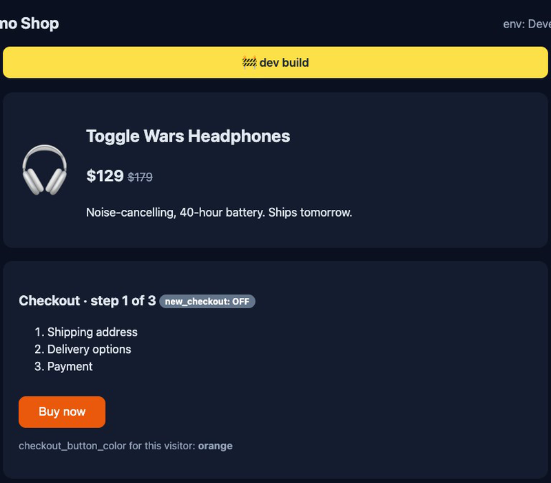 **The demo shop** (`make demo`): banner, checkout and button colour all come from self-hosted Flagsmith. |
|  **Archived and stale flags** show up as problems, computed locally on open-source Flagsmith. |  **Same data as the dashboard**: every value comes from your self-hosted Flagsmith. |
| 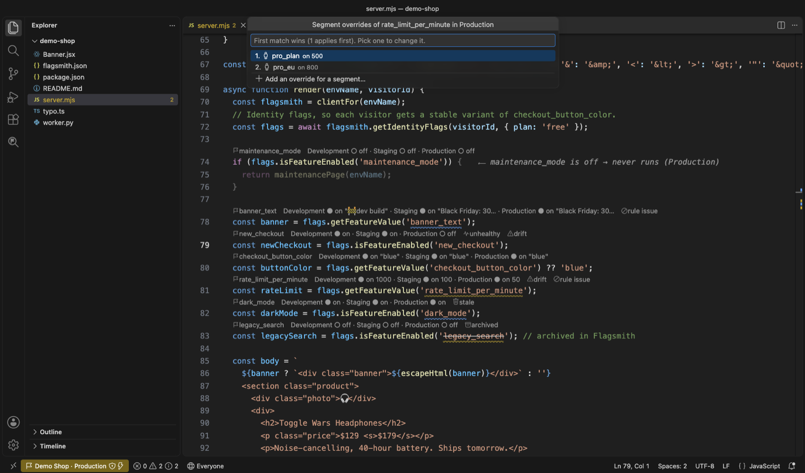 **Edit segment overrides** in priority order, right from the editor. Move `pro_eu` above `pro_plan` and the rule check's finding disappears. | 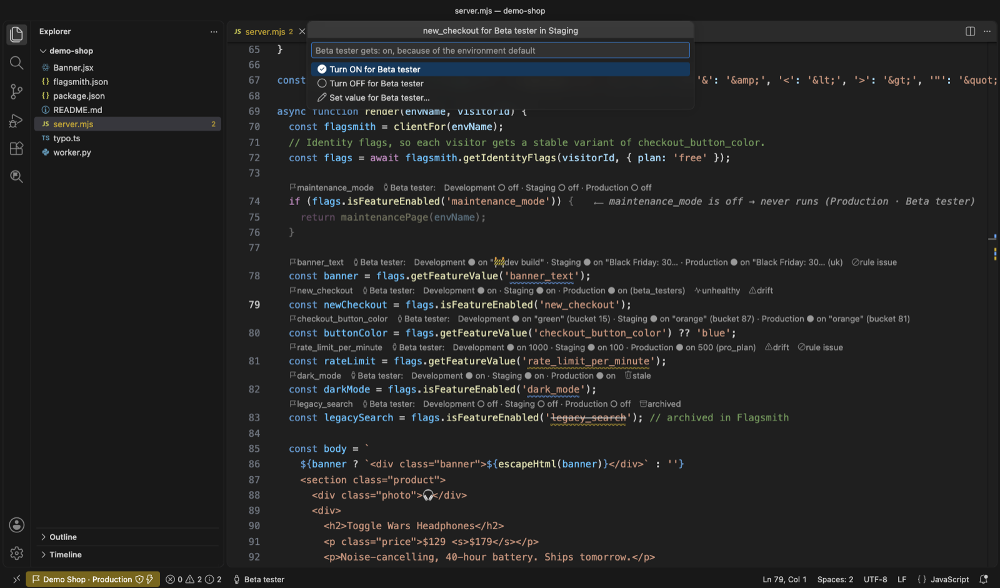 **Set a flag for one user**: an identity override for the user you are previewing as, with Undo. |
| 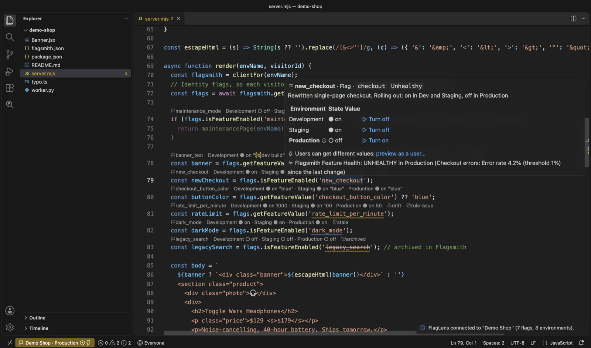 **Feature Health in the hover**: Flagsmith reports `new_checkout` unhealthy in Production, with the reason. The lightning bolt in the status bar means real-time updates are on. | 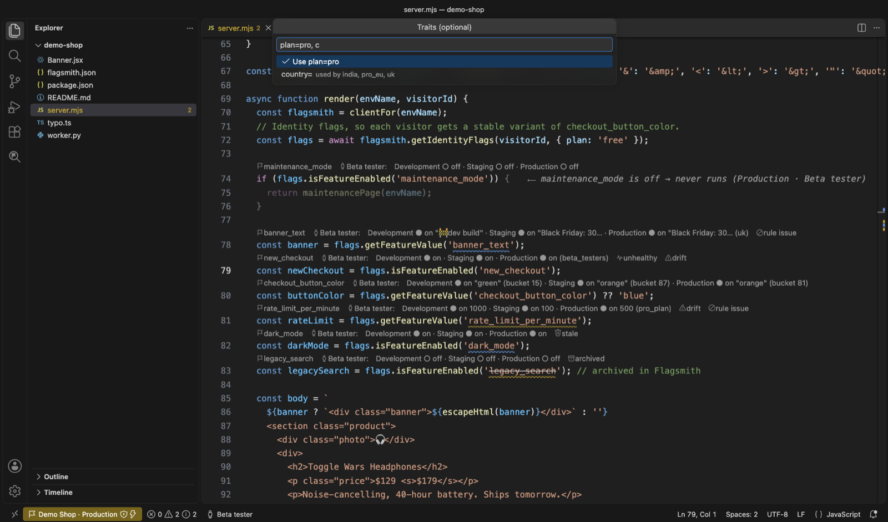 **Trait suggestions** for a custom identity, from the traits the segment rules read. |
| 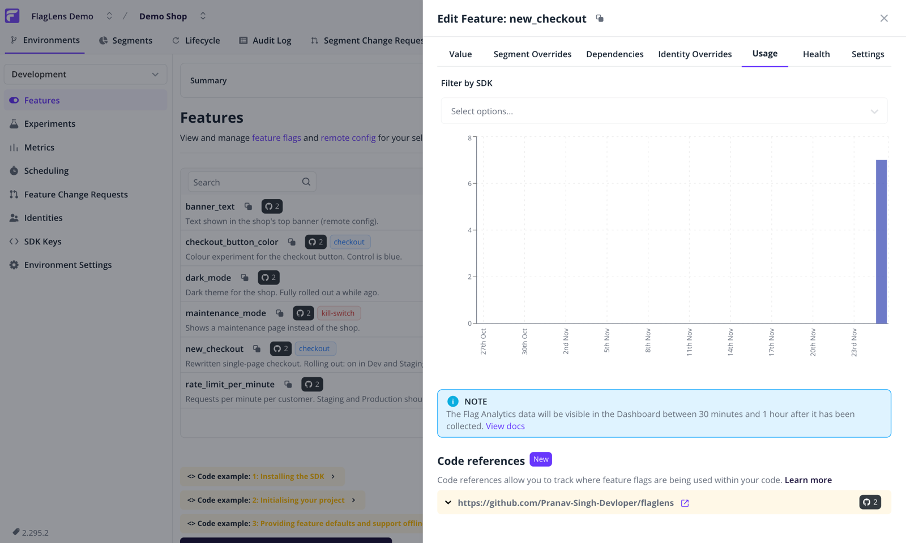 **Code References in Flagsmith**, published by FlagLens: each flag gets a GitHub badge with its count, and links to the lines in this repository. | 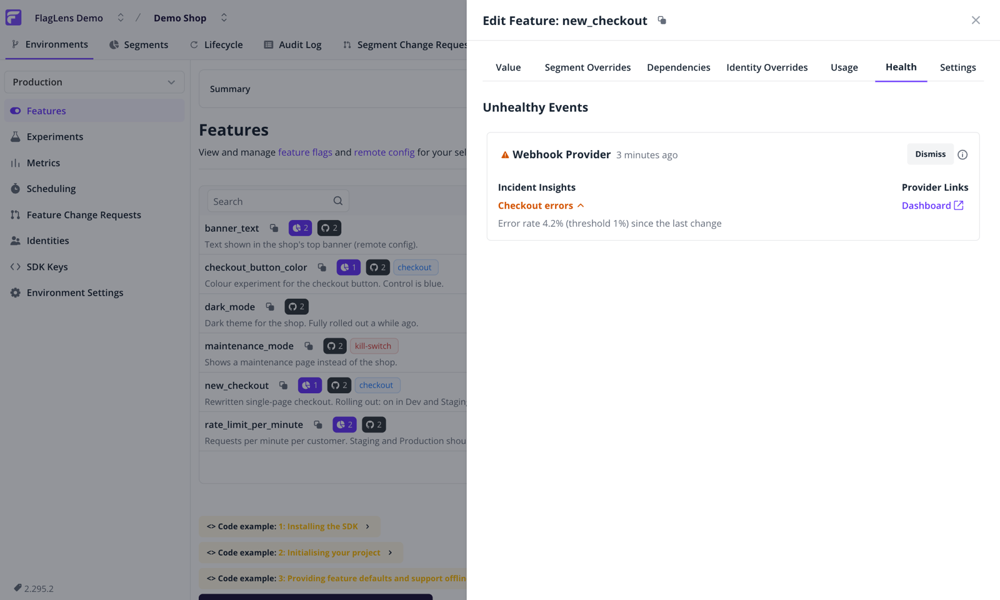 **The same alert in Flagsmith**: the Feature Health event that FlagLens shows in the editor (`make alert`). |

## Why

- **Context switching.** You read `isFeatureEnabled("new_checkout")` and can't tell whether it's on in production
  without opening the dashboard, picking the project, then the environment, then searching. Then again for staging.
- **Environment drift.** "What you want to know at 2 AM is whether staging and production disagree." Today that means
  clicking through every environment.
- **Silent typos.** `isFeatureEnabled("new_chekout")` doesn't error: every SDK returns the default and the feature
  never ships.
- **"Which branch actually runs for this user?"** Segments, % splits and identity overrides decide, and they live in
  the dashboard, far from the `if` they control. Reading the code, you can't tell which half is dead.
- **Flag debt on open source.** Flags stay fully on for months. Flagsmith's stale-flag detection is a paid SaaS
  feature, and on self-hosted open-source Flagsmith even the audit-log API returns nothing. FlagLens computes
  staleness itself.

## What it does

| Feature | Flagsmith API it uses |
|---|---|
| Live state of every environment above each flag reference (CodeLens) and in a hover card with values, variant weights, overrides and last change | `GET /projects/{id}/features/`, `GET /environments/{key}/featurestates/` |
| **Preview as a user**: pick a test user (identifier + traits) from the status bar, and every CodeLens, hover and greyed-out region shows what *that user* gets, and why: segment and priority, % split bucket, identity override. Evaluated locally from the environment document with Flagsmith's own rules (ported from its open-source engine), and [verified against the server](#development-and-tests) | `GET /environments/{key}/document/` |
| **Greys out code that can't run** in the active environment (and for the previewed user), like an inactive `#ifdef`: the losing branch of `if`/`else` and ternaries, through simple `const x = flags…` aliases, and the rest of a block after a flag guard that returns. JS/TS and other brace languages, and Python. It uses three-valued logic, so it only greys code when the outcome is **certain**: a flag with a segment override counts as unknown for "everyone" | environment document + feature states |
| **Targeting rule check**: finds segment overrides that can **never apply** (every user they match is caught first by higher-priority overrides), overrides that **change nothing**, segments that **match nobody**, and defaults **nobody gets**. Each finding is proven for every possible user (see [How the checks work](#how-the-checks-work)). Shown in CodeLens, hovers, the Problems panel and a Markdown report | environment documents |
| **Pairwise test plan**: the smallest set of runs in which every pair of values of the chosen flags appears together. Provably optimal for on/off flags (Kleitman–Spencer); near-optimal with a stated lower bound for multivariate flags. Exports a table, JSON and a GitHub Actions matrix | feature states, variants, environment documents |
| **Safe toggles and value edits**: modal confirmation, typed confirmation for protected environments (`prod\|live\|main`), Undo, every change logged. In environments with **feature versioning (v2)** a change is published as a new version | `PATCH /environments/{key}/featurestates/{id}/`; v2: `POST /environments/{id}/features/{id}/versions/` |
| **Real-time updates**: a change made anywhere (dashboard, API, a teammate) shows up within a few seconds. FlagLens registers a Flagsmith organisation webhook pointing at a small listener in the editor (random port and path, every call checked against its HMAC-SHA256 signature) and removes it when the window closes; polling stays as the fallback | `POST /organisations/{id}/webhooks/` |
| **Set a flag for one user**: while previewing as a user, turn a flag on or off or set its value for that identity only, or remove the override. The confirmation says exactly who is affected | `/environments/{key}/identities/{id}/featurestates/` |
| **Edit segment overrides**: add one for a segment, turn it on or off, change its value, move it up or down, remove it. The rule check runs again straight away, so moving a shadowed override up makes the finding disappear | `create-segment-override`, `feature-segments`, `update-priorities` |
| **Drift badge** when Staging ≠ Production, **Environment Matrix** of every flag × environment, **Copy diff as Markdown** for a PR | feature states × environments |
| **Typo detection** for unknown keys with *Replace with…* and *Create flag in Flagsmith…* quick fixes (respects the project's naming rules) | `POST /projects/{id}/features/` |
| **Stale flags on open-source Flagsmith**: identical in every environment for N days, no targeting, not tagged permanent | `updated_at` of feature states, tags (`is_permanent`) |
| **Archived flags still referenced** in code are flagged for removal | `is_archived` |
| **Flag dependencies**: a flag that requires another shows *Requires `parent`* in the hover and a *blocked* badge where the parent is off, so it can't serve on however it is set. *Preview as* evaluates dependencies per user exactly as the server does | environment documents (Flagsmith stores a dependency as a system segment with a `$.flags[...]` condition) |
| **Publish Code References to Flagsmith**: one command (or `make code-refs` in CI) uploads every flag reference in the repository, in the format of Flagsmith's own scanner. The Flagsmith dashboard then lists each flag's files and lines with links to GitHub, counts them in the flag list, and moves flags from *new* to *live* | `POST /projects/{id}/code-references/` |
| **Feature Health**: when monitoring (Grafana, Alertmanager, anything that can POST) reports a flag unhealthy through Flagsmith's Feature Health webhook, FlagLens badges it *unhealthy* at every reference, shows the reason and links in the hover, and repeats the warning in the confirmation before anyone toggles it | `GET /projects/{id}/feature-health/events/` |
| **Lifecycle and owners**: Flagsmith's lifecycle stage (*new*, *live*, *stale*, *permanent*, *to remove*…), its code-reference count and the flag's owners appear in the hover; *to remove* is also a badge | `GET /projects/{id}/features/?environment=` |
| **FlagLens in CI**: `flaglens check` (a GitHub Action, or `make flag-check`) runs the editor's checks over a repository: unknown flag keys with a suggested fix, archived flags still in code, and targeting-rule mistakes. The report goes to the job summary and, on pull requests, a comment; `strict` fails the build | features list, environment documents |
| **Kill switch for unhealthy flags**: when Feature Health newly reports a flag unhealthy where it is on, FlagLens says so once and offers *Turn off in <environment>* (also in the hover), with the usual confirmation and Undo | feature states |
| **Experiment lock**: flags in a running experiment are badged and can't be toggled | `GET /environments/{key}/experiments/` (beta) |
| Autocomplete flag keys inside `isFeatureEnabled("…")`, sidebar tree, status-bar environment switcher, flag history, *Find unused flags* in the workspace | all of the above |
| **Dev kit**: pinned official images, idempotent REST seed, demo shop using the official Node SDK | Docker, REST, SDK API |

It fits the existing Flagsmith toolchain instead of inventing its own:

- It reads **`flagsmith.json`**, the config file written by the official Flagsmith CLI (`flagsmith init`), to pick
  the project and default environment.
- It finds flag keys with **the same pattern as Flagsmith's own Code References scanner**
  ([Flagsmith/ci](https://github.com/Flagsmith/ci)), so `is_feature_enabled("x")`, `isFeatureEnabled('x')`,
  `hasFeature("x")`, `getFeatureValue("x")`, `IsFeatureEnabled("x")`… work in JS/TS, Python, Go, Java, Kotlin, C#,
  Dart and Ruby. Two extra patterns add the JS client's `flagsmith.getValue('x')` and the React SDK's
  `useFlags(['x', 'y'])`, which the official scanner misses.

## Quick start (about 5 minutes)

> **Checked on a fresh clone on 26 Nov 2026:** `git clone` → `make reset` → `make up` → `make seed` (twice) →
> `npm ci` → `npm run check` (190 tests at the time) → `make package` took 63 seconds with the Docker images already downloaded.
> The first `make up` also pulls the images (1–3 minutes). CI runs the same steps on a fresh Ubuntu machine on every push.

**Prerequisites:** [Docker](https://docs.docker.com/get-docker/) with Compose v2 (Docker Desktop is fine),
Node.js 22 or newer, VS Code 1.95 or newer, and `make` (on Windows, use the `npm run …` command shown next to each step).

```bash
git clone https://github.com/Pranav-Singh-Devloper/flaglens.git && cd flaglens

make up      # start self-hosted Flagsmith 2.295.2 on http://localhost:8000      (npm run devkit:up)
make seed    # admin user, "Demo Shop" project, 3 environments, 7 flags, .env      (npm run devkit:seed)
make demo    # the demo shop on http://localhost:3030, reading flags via the SDK   (npm install && npm run demo)
```

The first `make up` pulls the images and runs database migrations, which takes 1–3 minutes. It returns once Flagsmith
is healthy.

Then install the extension, in one of these ways:

- **Cursor, VSCodium, Windsurf, Gitpod and other VS Code forks:** search for **FlagLens** in the Extensions view; it
  is on [Open VSX](https://open-vsx.org/extension/pranav-singh-devloper/flaglens) (verified publisher).
- **VS Code: download** the latest `flaglens-<version>.vsix` from [Releases](https://github.com/Pranav-Singh-Devloper/flaglens/releases/latest),
  then in VS Code: Command Palette → **Extensions: Install from VSIX…** → pick the file.
- **Or build it**: `make package` (npm: `npm install && npm run package`) creates `extension/flaglens.vsix`. If the
  `code` command is on your PATH, `make install-ext` builds and installs it in one step.

Finally open the demo workspace: **File → Open Folder… → `flaglens/examples/demo-shop`**
(or `code examples/demo-shop`). FlagLens notices the `.env` that `make seed` wrote and asks
**"Connect with it?"**. Click **Connect**.

### What success looks like

- `make seed` ends with a box: `✔ Self-hosted Flagsmith is seeded and ready.`
- VS Code's status bar shows **`⚑ Demo Shop · Development`**.
- In `server.mjs`, above `isFeatureEnabled('new_checkout')`, you see
  `⚑ new_checkout   Development ● on · Staging ● on · Production ○ off`, and `rate_limit_per_minute` shows a **drift** badge.
- `typo.ts` has a yellow squiggle under `new_chekout` (try the quick fix) and a blue hint on `dark_mode` (stale).
- Click the `new_checkout` CodeLens → **Turn off in Development** → confirm. Within 3 seconds the shop at
  http://localhost:3030 switches back to the classic checkout. Try Production: you'll be asked to type the flag name.
- Code that can't run is greyed, with the reason at the end of the line: in `server.mjs` the old three-step checkout
  shows `⟵ new_checkout is on → never runs (Development)`, and in `typo.ts` the branch behind the typo is greyed
  because `new_chekout` doesn't exist.
- Click **Everyone** in the status bar → **Beta tester**, then switch to Production (click the environment in the
  status bar). The `new_checkout` CodeLens now reads `Production ● on (beta_testers)`, the old checkout is greyed out
  for this user, and the hover shows which segment decided.
- The Problems panel lists two **targeting rule** findings in `server.mjs`: the `pro_eu` override for
  `rate_limit_per_minute` never applies (shadowed by `pro_plan`), and the `uk` override for `banner_text` changes
  nothing. **FlagLens: Check Targeting Rules** shows them as a report.
- **FlagLens: Generate Pairwise Test Plan…** with `server.mjs` open preselects its flags. *On/off only* gives
  **7 runs instead of 96**.
- The Flagsmith dashboard at http://localhost:8000 shows the same change. Log in with
  `admin@flaglens.local` / `FlagLens-demo-2026`.
- **Real time:** the status bar shows a lightning bolt (`⚑ Demo Shop · Development ⚡`). Toggle a flag in the
  dashboard: the CodeLens in VS Code changes within a few seconds.
- **Fix the rule from the editor:** hover `rate_limit_per_minute` → **Segment overrides…** → Production → `pro_eu` →
  **Move up**. After confirming, the "never applies" finding is gone. (`make seed` puts the mistake back.)
- **One user only:** while previewing as *Beta tester*, hover a flag → **Set for Beta tester…** → *Turn OFF*. Only
  that user changes; *Everyone* still sees the default.
- **Feature Health:** `make alert` marks `new_checkout` unhealthy in Production: on the next refresh (within half a minute) its
  CodeLens shows *unhealthy*, the hover shows the reason, and toggling it warns you. `make recover` clears it.
- **Code References:** run `make code-refs` (or **FlagLens: Publish Code References to Flagsmith…**), then open
  `new_checkout` in the dashboard: its *Code References* list links to the lines in this repository.

Something wrong? See [Troubleshooting](#troubleshooting).

## Use it with your own Flagsmith

1. Command Palette → **FlagLens: Connect to Flagsmith**.
2. Enter your API URL: your self-hosted instance (e.g. `https://flags.mycompany.com`), or `https://api.flagsmith.com`
   for Flagsmith Cloud.
3. Paste an **Organisation API key** (dashboard → Organisation Settings → API Keys). It is stored in VS Code's
   encrypted SecretStorage, one key per server, and never written to settings or logs.
4. Pick the project. If your repo already has a `flagsmith.json` from the Flagsmith CLI, FlagLens uses it
   (`project` and `environment` may be ids, names or a client-side key).

## Commands

| Command | |
|---|---|
| FlagLens: Connect to Flagsmith… / Sign Out (Forget API Key) | Connect, or forget the stored API key |
| FlagLens: Toggle Flag… / Set Flag Value… | Change a flag in one environment (with confirmation) |
| FlagLens: Create Flag in Flagsmith… | Create a flag (starts OFF everywhere) |
| FlagLens: Open Environment Matrix | Every flag × environment, differences highlighted, click to toggle |
| FlagLens: Copy Environment Diff as Markdown… | Paste-ready table of differences between two environments |
| FlagLens: Show Flag History… | Audit log (if the server exposes it), last change per environment, changes made with FlagLens |
| FlagLens: Find Unused Flags in Workspace | Project flags that no file references |
| Sidebar: click a flag / right-click | *Flag Actions…* (toggle, set value, history, …); right-click for *Open in Flagsmith Dashboard* and *Copy Flag Key* |
| FlagLens: Set Flag for Previewed User… | Identity override for the user you are previewing as (also a link in the hover) |
| FlagLens: Edit Segment Overrides… | A flag's overrides in one environment, in priority order: add, change, reorder, remove (also a link in the hover) |
| FlagLens: Publish Code References to Flagsmith… | Upload every flag reference in this repository (git HEAD, GitHub remote) to Flagsmith's Code References, after a confirmation |
| FlagLens: Preview Flags as User… | Pick a test user (from `flaglens.personas`, or type an identifier and traits). Also: click the persona item in the status bar |
| FlagLens: Toggle Greying Out Code That Won't Run | Turn the greying on or off |
| FlagLens: Check Targeting Rules | Report of segment overrides that never apply, change nothing or match nobody, per environment |
| FlagLens: Generate Pairwise Test Plan… | Pick flags (the open file's are preselected): the smallest plan covering every pair of their values |
| FlagLens: Switch Active Environment… / Switch Project… / Refresh Flags / Show Log | |

## Configuration

| Setting | Default | Purpose |
|---|---|---|
| `flaglens.apiUrl` | `http://localhost:8000` | Flagsmith API base URL, without `/api/v1`. If unset: `apiUrl` in `flagsmith.json`, then `FLAGSMITH_API_URL` in the workspace `.env`. |
| `flaglens.dashboardUrl` | same as `apiUrl` | Dashboard base for links (`https://app.flagsmith.com` is used automatically for Cloud) |
| `flaglens.projectId` | from `flagsmith.json` | Project to show |
| `flaglens.activeEnvironment` | from `flagsmith.json` | Environment used by the status bar, tree and autocomplete |
| `flaglens.refreshIntervalSeconds` | `10` | Polling interval (minimum 3) |
| `flaglens.protectedEnvironments` | `prod\|live\|main` | Case-insensitive regex; matching environments need the flag name typed to confirm a change |
| `flaglens.driftEnvironments` | `["Staging", "Production"]` | The pair compared for the drift badge |
| `flaglens.staleAfterDays` | project's `stale_flags_limit_days`, else `30` | Days unchanged before a uniform flag counts as stale |
| `flaglens.permanentTags` | `["permanent", "kill-switch"]` | Tags that are never stale (tags marked *permanent* in Flagsmith count too) |
| `flaglens.extraPatterns` | `getValue` and `useFlags` patterns | Extra regexes with a named group `key` |
| `flaglens.codeLens.enabled` | `true` | Show the inline states |
| `flaglens.diagnostics.unknownFlagSeverity` | `warning` | `error`, `warning`, `information` or `off` |
| `flaglens.diagnostics.staleFlags` | `true` | Show stale-flag hints |
| `flaglens.personas` | `[]` | Test users for *Preview as*: `[{ "name": "Beta tester", "identifier": "alice@demo-shop.dev", "traits": { "plan": "pro" } }]`. The demo workspace defines three |
| `flaglens.dimInactiveCode` | `true` | Grey out code that can't run in the active environment (and for the previewed user) |
| `flaglens.realtime.mode` | `auto` | Real-time updates through a Flagsmith webhook: `auto` when Flagsmith runs on this machine, `on` to always try, `off` to poll only |
| `flaglens.realtime.callbackHost` | `host.docker.internal` | Host name Flagsmith uses to reach this machine. Flagsmith must allow it in `SSRF_ALLOWED_HOSTS` (the dev kit does) |

## Environment variables (dev kit)

`make seed` writes a git-ignored `.env` at the repo root and a copy in `examples/demo-shop/.env`.
[`.env.example`](.env.example) documents every variable. You only need to set one yourself to change a default
**before** seeding.

| Variable | Default | Used by | Purpose |
|---|---|---|---|
| `FLAGSMITH_API_URL` | `http://localhost:8000` | seed, demo shop, extension | Flagsmith base URL |
| `FLAGSMITH_API_KEY` | written by seed | extension (offered on first open) | Organisation API key. **Secret.** |
| `FLAGSMITH_ORGANISATION_ID` | written by seed | reference | |
| `FLAGSMITH_PROJECT_ID` | written by seed | extension | |
| `FLAGSMITH_ENV_KEY_DEVELOPMENT`, `…_STAGING`, `…_PRODUCTION` | written by seed | demo shop | Client-side environment keys (public by design) |
| `FLAGSMITH_HEALTH_WEBHOOK_URL` | written by seed | `make alert` / `make recover` | Feature Health webhook of the demo project. **Secret** (the URL contains its token) |
| `ADMIN_EMAIL` / `ADMIN_PASSWORD` | `admin@flaglens.local` / `FlagLens-demo-2026` | seed | Dev-kit dashboard login |
| `DEMO_PORT` | `3030` | demo shop | |
| `DEMO_ENVIRONMENT` | `Development` | demo shop | Environment the shop reads by default (`?env=Production` overrides) |
| `FLAGSMITH_PORT` | `8000` | `make up` (shell variable) | Host port if 8000 is taken: `FLAGSMITH_PORT=8080 make up`, then set `FLAGSMITH_API_URL=http://localhost:8080` |

### Dev kit commands

| make | npm | |
|---|---|---|
| `make up` | `npm run devkit:up` | Start Flagsmith (waits until healthy) |
| `make seed` | `npm run devkit:seed` | Seed or re-seed. Safe to re-run: it restores every demo flag to its declared state ([`devkit/seed-data.json`](devkit/seed-data.json)) |
| `make demo` | `npm run demo` | Run the demo shop |
| `make down` / `make reset` | `npm run devkit:down` / `devkit:reset` | Stop / stop **and delete all data** |
| `make logs` | `npm run devkit:logs` | Follow Flagsmith logs |
| `make mcp` | `npm run devkit:mcp` | Also start Flagsmith's MCP server on :8002 |
| `make help` | | List every target |
| `make install` / `make ext` / `make package` | `npm install` / `npm run build` / `npm run package` | Install dependencies, build the extension, build `extension/flaglens.vsix` |
| `make install-ext` | | Build the `.vsix` and install it with the `code` command |
| `make test` / `make lint` / `make typecheck` / `make check` | `npm test` / `npm run lint` / `npm run typecheck` / `npm run check` | Unit tests, lint, type-check, or all three |
| `make verify-engine` | `npm run verify:engine -w extension` | Compare FlagLens's local evaluation with the running Flagsmith |
| `make flag-check` | `node extension/scripts/check.mjs --path examples/demo-shop` | The editor's checks for a whole folder, as CI runs them: unknown keys, archived flags in code, rule mistakes |
| `make code-refs` | `npm run code-refs -w extension` | Publish this repository's flag references to Flagsmith's Code References (what a CI job would run) |
| `make alert` / `make recover` | `node devkit/health.mjs alert\|recover` | Mark `new_checkout` unhealthy (or healthy again) in Production through the Feature Health webhook, as a monitoring tool would |

The seeded flags are designed so every feature is visible:

| Flag | Development | Staging | Production | Shows |
|---|---|---|---|---|
| `new_checkout` | on | on | off | Toggle it live; the shop's checkout changes |
| `banner_text` | `🚧 dev build` | `Black Friday: 30% off` | `Black Friday: 30% off` | Values inline; the shop banner |
| `rate_limit_per_minute` | 1000 | 100 | 50 | **drift** between Staging and Production |
| `checkout_button_color` | blue / green 50% / orange 50% | same | same | Multivariate variants and weights |
| `dark_mode` | on | on | on | **Stale** (the demo workspace sets `staleAfterDays: 0`) |
| `maintenance_mode` | off | off | off | Tagged `kill-switch` (permanent), so never stale |
| `legacy_search` | off | off | off | **Archived** but still referenced |

Production also has four segments with overrides, so *Preview as* has something to show (the demo workspace's
`flaglens.personas` match them):

| Segment | Rule | Production override |
|---|---|---|
| `beta_testers` | `email` matches `.*@demo-shop\.dev$` | `new_checkout` on |
| `pro_plan` | `plan` = `pro` | `rate_limit_per_minute` = 500 |
| `india` | `country` = `IN` | `banner_text` = "Diwali sale: 40% off" |
| `canary_10pct` | 10% split on the identity | `checkout_button_color` = purple |
| `pro_eu` | `plan` = `pro` and `country` in DE, FR, GB | `rate_limit_per_minute` = 800. **Deliberate mistake:** `pro_plan` catches these users first |
| `uk` | `country` = `GB` | `banner_text` = "Black Friday: 30% off". **Deliberate mistake:** the same as the default |

## How it uses Flagsmith

Remove Flagsmith and FlagLens does nothing: every badge, value and warning is live data from the Flagsmith API, and
every change is a Flagsmith write.

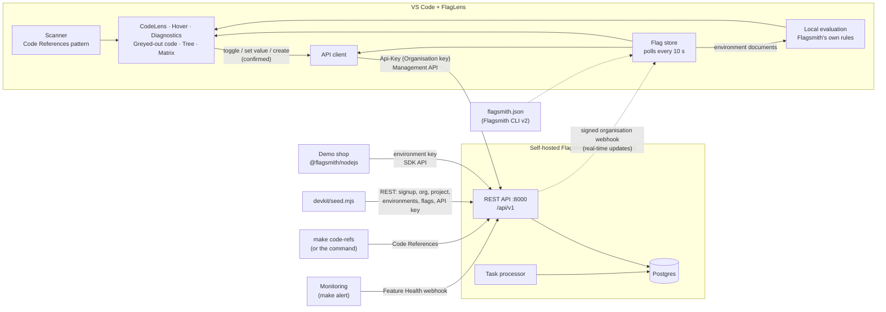

- **Management API, read.** On each refresh: environments, `GET /projects/{id}/features/`, tags, and one
  `GET /environments/{key}/featurestates/` per environment. This gives enabled, value, `updated_at` and per-environment
  variant weights for every flag in N+1 requests, joined into a feature × environment matrix. Experiments (beta) are
  read per environment to show the lock badge.
- **Environment documents.** `GET /environments/{key}/document/` (readable with the same Organisation key) returns
  every flag's default, every segment with its rules and overrides, and identity overrides: the document Flagsmith's
  server-side SDKs use for local evaluation. FlagLens evaluates it with a TypeScript port of Flagsmith's open-source
  engine (identity key `envkey_identifier`, `md5` percentages mod 9999, segment priorities, multivariate buckets,
  all 14 rule operators), which powers *Preview as* and tells the greying-out exactly which flags are the same for
  every user.
- **Management API, write.** Toggles and values are `PATCH /environments/{key}/featurestates/{id}/` on the
  environment's default state (raw JSON values keep their type); in v2-versioned environments they are one
  `POST /environments/{id}/features/{id}/versions/` that creates and publishes a version. New flags are
  `POST /projects/{id}/features/`. Identity overrides use `/environments/{key}/identities/` (find or create the
  identity) and its `featurestates/`. Segment overrides use `create-segment-override/`, `PUT /features/featurestates/{id}/`,
  `DELETE /features/feature-segments/{id}/` and `update-priorities/`, with the project's segments from
  `GET /projects/{id}/segments/`. Every write also appears in Flagsmith's own audit log.
- **Webhooks.** On connect FlagLens registers `POST /organisations/{id}/webhooks/` with a random secret, receives
  `FLAG_UPDATED` and `AUDIT_LOG_CREATED` events, refreshes, and deletes the webhook when the window closes.
- **Trait keys.** `GET /environments/{key}/trait-keys/` (traits stored on identities) plus the traits segment rules
  read become suggestions when you preview as a custom identity.
- **Newer project APIs.** The features list with `?environment=` adds each flag's lifecycle stage, code-reference
  count and owners. `GET /projects/{id}/feature-health/events/` gives the latest Feature Health status per flag and
  environment. *Publish Code References* sends `POST /projects/{id}/code-references/` with the repository, the commit
  and every `{file_path, line_number, feature_name}`. Flag dependencies need no extra request: they are in the
  environment document as system segments.
- **SDK API.** The demo shop uses the official `@flagsmith/nodejs` SDK with remote evaluation and per-visitor
  identities, so it serves multivariate variants and picks up changes on the next request.
- **Dev kit.** It runs Flagsmith's official Docker images (API and task processor; the task processor sends the
  webhooks) and allows `host.docker.internal` in `SSRF_ALLOWED_HOSTS` so Flagsmith may call the editor. The seed also
  creates a Feature Health *Webhook* provider (`POST /projects/{id}/feature-health/providers/`) for `make alert`.
  The seed uses only the public REST API (signup → organisation → project → environments → tags → flags →
  Organisation API key), so it doubles as a worked example of bootstrapping Flagsmith without clicking.

## FlagLens in CI

The same checks run outside the editor, so a pull request can't introduce a flag typo or a dead targeting rule unnoticed:

```yaml
# .github/workflows/flags.yml
on: pull_request
permissions: { contents: read, pull-requests: write }
jobs:
  flags:
    runs-on: ubuntu-latest
    steps:
      - uses: actions/checkout@v4
      - uses: Pranav-Singh-Devloper/flaglens@v0.6.0
        with:
          api-url: https://flagsmith.example.com
          api-key: ${{ secrets.FLAGSMITH_API_KEY }}   # an Organisation API key
          project-id: 12
          strict: true                                # fail the job when there are problems
```

The report lists each unknown key with a suggested fix and a link to the line, archived flags still in code, and
every targeting-rule finding. This repository's own CI runs it against the demo shop on every push (see the job
summary); locally, `make flag-check`.

## How much of Flagsmith it uses

We went through Flagsmith 2.295.2's OpenAPI spec (about 300 paths) and probed the self-hosted instance to see what
the open-source edition offers, then built on as much of it as an editor tool can use well.

| | Flagsmith feature | In FlagLens |
|---|---|---|
| **Used** | Projects, environments, flags, feature states, tags, project settings (`feature_name_regex`, `stale_flags_limit_days`) | Everything inline, toggles, value edits, create flag, naming rules, staleness |
| | Environment documents: segments, rules (all 14 operators), priorities, % splits, multivariate variants, identity overrides | *Preview as*, greying out, rule check, test plans |
| | Flag dependencies (system segments with `$.flags[...]` conditions) | *Requires* / *blocked*, evaluated per user like the server |
| | Code References API | Publish from the editor or CI; counts in the hover |
| | Lifecycle stages and flag owners | Hover, *to remove* badge |
| | Feature Health (Webhook provider and events) | *Unhealthy* badge, reason, warning in the confirmation; `make alert` / `make recover` |
| | Transient identities (SDK API) | Differential test of the local engine against the server |
| | Experiments (beta) | Lock badge; experiment flags can't be toggled |
| | Audit log | *Show history*, when the server exposes it |
| | Organisation webhooks (signed) | Real-time updates, with polling as the fallback |
| | Identity overrides | *Set flag for previewed user* |
| | Segment overrides and their priorities | *Edit segment overrides*, re-checked by the rule check |
| | v2 feature versioning (versions, publish) | Toggles and value changes publish a version |
| | Trait keys | Suggestions when previewing as a custom identity |
| | Flagsmith CLI (`flagsmith.json`), Code References scanner pattern, Node SDK, MCP server | Config, flag detection, demo shop, `make mcp` |
| | Flagsmith's open-source evaluation engine | Ported to TypeScript for local evaluation; verified against the server (15,050 checks) |
| | Official Docker images (`flagsmith/flagsmith` API and task processor, `flagsmith/flagsmith-mcp`) | The dev kit: `make up`, `make mcp` |
| **Not yet** (open source) | Metadata fields, usage analytics, segment and flag-dependency editing, Edge identities | Analytics needs server-side setup; the others are dashboard work that doesn't need the code next to it |
| **Not in open source** | Change requests (4-eyes approval), scheduled changes, real-time flag updates (SSE), full audit-log visibility, SSO and role-based access | Webhooks give FlagLens real-time updates anyway; its typed confirmation for protected environments and its change journal cover part of change requests and the audit log |

## How the checks work

**Targeting rules.** Segment overrides are a priority-ordered list of rules over user traits, which is exactly the
shape of a firewall policy, so FlagLens borrows its anomaly taxonomy (Al-Shaer & Hamed, *Firewall Policy Advisor*,
2004): an override is **shadowed** when higher-priority ones catch every user it matches, and **redundant** when
removing it changes no user's result. Checking "every user" exactly is possible because each comparison operator
(`=`, `≠`, `IN`, `<`, `≤`, `>`, `≥`, `IS_SET`, % split) gives the same answer for all values between two consecutive
constants that appear in the rules. Trait values therefore split into a few equivalence classes (unset, each constant,
each gap, other strings, numbers and booleans, since the engine casts the condition to the trait's type), and
checking one representative per class combination is a proof for all users. Operators that can't be split this way
(regex, contains, modulo, SemVer) become free true/false variables, which only adds impossible users: a finding can be
missed, but never invented. A randomised test checks this against the evaluation engine on 150 random rule sets, and
`make verify-engine` confirms on the live server that users inside a shadowed segment never get its value.

**Pairwise plans.** Most flag bugs involve one flag or the interaction of two, so a plan that puts every pair of
values together in some run catches them without trying every combination. For on/off flags the minimum is known
exactly: the smallest N with C(N−1, ⌈N/2⌉) ≥ k (Katona; Kleitman & Spencer, 1973), reached by giving each flag a
distinct length-N column that starts with 0 and has ⌈N/2⌉ ones. That is 6 runs for 10 flags, 10 for 100 and 14 for
1,000. With multivariate flags FlagLens builds a plan with IPOG (Lei et al., 2007), shrinks it with simulated annealing
(Cohen, Colbourn & Ling, 2003), and states a lower bound so you know how close it is.

## Architecture

```
devkit/            compose.yaml (pinned 2.295.2 + optional MCP), seed.mjs + seed-data.json (zero-dependency Node),
                   health.mjs (make alert / make recover)
extension/src/
  api/             typed Management API client: fetch, Api-Key auth, pagination, timeouts, typed errors
  core/            PURE logic, unit-tested: scanner (Code References pattern), model (matrix), analysis (drift,
                   stale, typo suggestions, name rules), report (Markdown diff), engine (Flagsmith's evaluation
                   rules, ported), deadcode (lexer + if/else/ternary/alias analysis with three-valued logic),
                   rules (override anomalies over trait equivalence classes), pairwise + testPlan (covering arrays),
                   webhook (signature check, event parsing), traitHints (trait suggestions)
  store/           FlagStore: refresh, change detection, offline handling with backoff, dependencies, health
  realtime.ts      webhook listener: registers and removes the Flagsmith webhook, refreshes on signed events
  providers/       CodeLens, hover, diagnostics + quick fixes, autocomplete, greyed-out code decorations
  views/           sidebar tree, status bar, Environment Matrix webview
  commands/        connect, toggle, set value, create, history, diff, find unused, preview as user, rule check,
                   test plan, identity and segment overrides, publish code references
  scripts/         verify-engine (differential test), publish-code-references (CLI for CI)
  safety.ts        confirmations, protected environments, write journal
examples/demo-shop the shop (Node SDK), plus Python / React / TypeScript files used in the demo
```

- **Zero runtime dependencies.** The extension uses only the VS Code API and Node's global `fetch`. The packaged
  `.vsix` is about 62 KB.
- Activation is cheap (`workspaceContains:**/flagsmith.json` or after startup). The matrix webview loads only when opened.
- Only open documents are scanned (debounced, cached by document version). *Find unused flags* scans the workspace on
  demand.

## Security

- The Organisation API key lives in VS Code SecretStorage only, keyed by server URL. It is never written to settings,
  logs or the workspace. **FlagLens: Sign Out** deletes it.
- Every change asks for confirmation. Protected environments also require typing the flag name, and Undo goes through
  the same check. Changes are logged to the *FlagLens* output channel and to Flagsmith's audit log.
- FlagLens warns when you connect to a remote server over plain `http://`.
- The real-time listener accepts only POSTs to a random 128-bit path, signed with a random 256-bit secret (HMAC-SHA256,
  compared in constant time), and a valid call only triggers a refresh: nothing in the payload is trusted. It listens
  on loopback where Docker Desktop allows it (macOS, Windows); on Linux it has to accept Docker's bridge network.
  `flaglens.realtime.mode: off` turns it off.
- Identity and segment override edits go through the same confirmation, which says who is affected.
- `FLAGSMITH_HEALTH_WEBHOOK_URL` contains the Feature Health webhook's token, so it stays in the git-ignored `.env`.
- In untrusted workspaces FlagLens ignores the workspace's `flagsmith.json` and `.env`, because they decide which server
  receives your key.
- The webview has a strict Content-Security-Policy (no remote content, nonce-only scripts).
- `.env` files are git-ignored. The dev kit uses Flagsmith's local defaults (`DJANGO_SECRET_KEY=secret`, Postgres
  password `password`). They are fine on your laptop: **don't expose the dev kit to the internet.**

## Development and tests

```bash
npm install
npm run check                    # lint + type-check + unit tests (extension and dev kit)
npm run build                    # bundle the extension (esbuild)
# Press F5 in VS Code (open the repo root) to start an Extension Development Host.

make up && make seed
npm run test:integration -w extension   # end-to-end: real VS Code + real self-hosted Flagsmith
make verify-engine                      # local evaluation vs the live server (npm run verify:engine -w extension)
```

- **Unit tests** (Vitest, ~190 tests) cover the scanner (call styles in 9 languages, multi-line calls, false
  positives), drift and staleness rules, typo suggestions, the API client (pagination, internal hostnames in `next`,
  timeouts, retry rules, error mapping), the Markdown diff, the evaluation engine (hashes checked against values
  computed independently with Python's `hashlib`, a chi-square test that splits are uniform, priorities, every
  operator), the dead-code analysis (if/else, guards, ternaries, aliases, Python, unknown operands), the rule checker
  (each anomaly, type casting, plus the randomised soundness test above) and the pairwise plans (exact optimal size
  for every k from 1 to 200, full pair coverage for 300 random mixes).
- **Engine verification** (`make verify-engine`) asks the running Flagsmith what hundreds of random identities get,
  using *transient* identities so nothing is stored, and compares every flag with FlagLens's local answer. A second
  pass creates one temporary segment per rule operator (`EQUAL` … `REGEX`, `IN`, `MODULO`, SemVer, `IS_SET`, % split,
  JSONPath properties) plus a flag dependency, runs the comparison, and deletes them again. Each pass also compares the
  flags served with no identity. Last run: 6,321 + 8,729 checks, **100% match**.
  It also checks the rule checker's "never applies" findings against the server.
- **End-to-end tests** launch VS Code with the demo workspace against the seeded Flagsmith and check CodeLens, hover,
  diagnostics, quick fixes, autocomplete, a real toggle and toggle-back, pick-up of a change made outside the editor,
  that a declined confirmation changes nothing, the Markdown diff, *Preview as* (including a comparison with the
  server's answer for the same user), greying out (including that nothing is greyed when users can differ), the rule
  check, the test plan, publishing Code References, a Feature Health alert (badge, hover and the warning in the
  confirmation), a flag dependency evaluated per user, real-time updates through a signed webhook (and its removal),
  an identity override, segment overrides (including fixing the shadowed rule by moving it up) and a change in a
  temporary v2-versioned environment.
- **CI** runs both on every push, including `make up && make seed` (twice, to prove the seed is idempotent) on a
  fresh Ubuntu runner.

## Limitations and roadmap

- **In v2-versioned environments only the default is edited** (published as a new version); segment overrides there
  are edited in the dashboard.
- **Real-time updates need Flagsmith to reach the editor.** That works out of the box when Flagsmith runs on the same
  machine (the dev kit). For a shared server, set `flaglens.realtime.mode` to `on` with a reachable
  `flaglens.realtime.callbackHost`, or keep polling (`refreshIntervalSeconds`, default 10).
- **Identity overrides are for core identities** (self-hosted Flagsmith). Edge identities (Flagsmith Cloud) use other
  endpoints and are not edited yet.
- **Flag dependencies are read, not created.** Add them in the dashboard; FlagLens shows and evaluates them.
- **Code References need a GitHub `origin` remote**, as Flagsmith's links point into GitHub.
- **Greying out is an analysis of common shapes, not a full parser.** It understands `if`/`else`, guards that return,
  ternaries and `const` aliases in the same block; JSX `{flag && <X/>}`, `switch` and values passed through other
  functions are left alone (never greyed by mistake: when unsure it does nothing).
- **Local evaluation assumes composite-key hashing** (`use_identity_composite_key_for_hashing`, the default on
  current Flagsmith). Environments created before that setting existed may bucket stored identities differently.
- **Detection is pattern-based**, like Flagsmith's Code References: keys built at runtime (`isFeatureEnabled(name)`)
  aren't seen. Custom wrappers can be added with `flaglens.extraPatterns`.
- **History on open-source Flagsmith is partial.** The server hides audit-log entries from the API without a
  licence, so *Show history* combines the audit log (when available), each environment's last change and FlagLens's own
  change journal.
- **Experiment results** aren't rendered yet; only the lock badge is.
- Single-root workspaces. Multi-root support (one connection per folder) is on the roadmap.

## Things we learned about Flagsmith while building this

Checked against a live 2.295.2 instance (these shaped the design):

- `last_modified_in_any_environment` is filled only by v2 feature versioning, so it's `null` on default environments.
  FlagLens uses feature-state `updated_at` instead.
- The project audit-log API returns no rows on unlicensed self-hosted instances (`audit_log_visibility_days = 0` on the
  free plan), even though the rows are in the database.
- `GET /api/v1/audit/` returns HTTP 500 when called with an Organisation API key
  ([Flagsmith#9117](https://github.com/Flagsmith/flagsmith/issues/9117)), and a partial
  `PATCH …/mv-options/{id}/` returns HTTP 500 (`KeyError: 'feature'`,
  [Flagsmith#9119](https://github.com/Flagsmith/flagsmith/issues/9119)). Multivariate
  `key`s sent when creating a feature are ignored. The seed works around this.
- `POST /projects/` creates no environments, and `GET /projects/` returns a plain array rather than a paginated object.
- `num_segment_overrides` in the features list is only counted when you pass `?environment=`; without it it's always 0.
  FlagLens counts overrides from the environment documents instead.
- `GET /environments/{key}/document/` works with an Organisation API key, so local evaluation needs no server-side
  environment key.
- A segment override of a multivariate flag copies the flag's variant split unless you send
  `multivariate_feature_state_values` with 0%, so the override's own value would never be served. The seed does that.
- A **flag dependency** is stored as an ordinary system segment named `<child>-depends-on-<parent>`, with the
  condition `$.flags["parent"].enabled NOT_EQUAL true` and an override that turns the child off. It applies with or
  without an identity and competes with the child's other overrides by priority, so a higher-priority override still
  wins. Chains (a prerequisite with its own prerequisite) are rejected with HTTP 400, so two evaluation passes give the
  exact answer.
- Publishing **Code References** moves a flag's lifecycle stage from *new* to *live*, and the stage is only returned
  by the features list when `?environment=` is passed.
- An **organisation webhook** receives `FLAG_UPDATED` for every environment and `AUDIT_LOG_CREATED` for every change
  (segments included), signed with `X-Flagsmith-Signature` (hex HMAC-SHA256 of the body). Flagsmith refuses webhook
  URLs on private addresses unless the host is in `SSRF_ALLOWED_HOSTS`, so the dev kit allows `host.docker.internal`.
  Calls go through the task processor and arrive in under two seconds.
- `PATCH /features/featurestates/{id}/` on a segment override returns HTTP 500 (`KeyError: 'environment'`,
  [Flagsmith#9118](https://github.com/Flagsmith/flagsmith/issues/9118), fixed in our pull request
  [Flagsmith#9123](https://github.com/Flagsmith/flagsmith/pull/9123)); `PUT` with
  the full body works, and values there must use the typed form (`{"type": "int", "integer_value": 7}`).
- In a v2-versioned environment, one `POST …/versions/` with `feature_states_to_update` and `publish_immediately`
  changes a flag; variant weights are kept. The v1 `PATCH` answers HTTP 400.
- The **Feature Health** webhook answers HTTP 400 unless `reason` has both `text_blocks` and `url_blocks`, even if one
  is empty.
- The `REGEX` operator is anchored at the start (Python's `re.match`): `demo-shop` doesn't match `a@demo-shop.dev`.
- Rule values are cast to the trait's type before comparing, so a boolean trait `true` EQUALs *any* value except
  `"false"`: a segment `plan = pro AND plan = free` does match someone (`plan: true`). The rule checker accounts for it.

## Troubleshooting

| Symptom | Fix |
|---|---|
| `make up` says port 8000 is in use | `FLAGSMITH_PORT=8080 make up`, then put `FLAGSMITH_API_URL=http://localhost:8080` in `.env` before `make seed` |
| `make seed`: "Could not log in" | You changed `ADMIN_PASSWORD` after the first seed. Start fresh: `make reset && make up && make seed` |
| Status bar shows a warning and "Can't reach Flagsmith" | Flagsmith isn't running: `make up`. FlagLens keeps the last known state and reconnects by itself |
| "Flagsmith rejected the API key" | After `make reset` the old key is gone. Run `make seed`, then **FlagLens: Connect to Flagsmith** → *Use the key from .env* |
| No "Connect with it?" prompt | Open the `examples/demo-shop` folder itself (the prompt reads `.env` at the workspace root), or run **FlagLens: Connect to Flagsmith** |
| `make demo` exits with "No FLAGSMITH_ENV_KEY_*" | Run `make seed` first |
| No lightning bolt in the status bar (polling only) | Hover the status bar item for the reason. The dev kit must be started with the current `compose.yaml` (`make up` again) so Flagsmith may call `host.docker.internal`. For a Flagsmith on another machine, set `flaglens.realtime.mode` to `on` and `flaglens.realtime.callbackHost` to an address it can reach |
| *Publish Code References* says it needs a GitHub remote | Flagsmith links references to GitHub; the repository needs an `origin` on github.com |
| `make alert` says the webhook URL is missing | Run `make seed` again; it writes `FLAGSMITH_HEALTH_WEBHOOK_URL` to `.env` |
| No CodeLens | Check `editor.codeLens` and `flaglens.codeLens.enabled` are on, and that the status bar says connected |

## Demo

**Demo video (2:33, 1080p60):** [YouTube](https://youtu.be/n9qszMKXoB4), with captions and chapters · [download the MP4](https://github.com/Pranav-Singh-Devloper/flaglens/releases/download/v0.5.1/flaglens-demo.mp4)

It follows the [three promises](#in-60-seconds): greying out and *Preview as* (it knows what runs), the rule check
and fixing a shadowed override from the editor (it proves your rules), a toggle in the Flagsmith dashboard reaching
VS Code in about 3 s and a Feature Health alert (it's live), then safe writes, the test plan and a montage of the rest.

Everything on screen is real: the VS Code footage is the released extension, driven by a script against the
self-hosted Flagsmith from `make up && make seed`. The video itself is built in code (Playwright-driven capture,
Remotion, an ElevenLabs voiceover checked by speech-to-text); see [video/](video/) to rebuild it. Reaction clips via
[Vlipsy](https://vlipsy.com), © their respective owners; they are not part of this repository.

## Research

[**FlagLens: Exact, Server-Verified Reasoning about Feature Flags in the Editor**](docs/paper/flaglens.pdf)
([Markdown version](docs/paper/flaglens.md)) describes the four analyses: the engine port and its differential
testing; dead-code detection with Kleene's three-valued logic; targeting-rule anomalies adapted from firewall-policy
analysis (Al-Shaer & Hamed), with a soundness theorem for the equivalence-class method; and covering arrays
(Katona; Kleitman & Spencer; IPOG; simulated annealing), including a lower bound for one multi-valued flag among
on/off flags. It cites the work we built on, from feature-toggle studies (Rahman et al., MSR 2016) and flag cleanup at
Uber and DoorDash to abstract interpretation and combinatorial testing.

## Built with AI assistance

AI coding assistants helped write parts of this project. Every line was reviewed, and the author understands and can
explain all of the code.

## Team · Licence

Built by [Pranav Singh](https://github.com/Pranav-Singh-Devloper) for Toggle Wars 2026 (WeMakeDevs × Flagsmith),
Track 03.

[MIT](LICENSE). Flagsmith is © Flagsmith Ltd. and BSD-3-Clause licensed; FlagLens is an independent community project.
